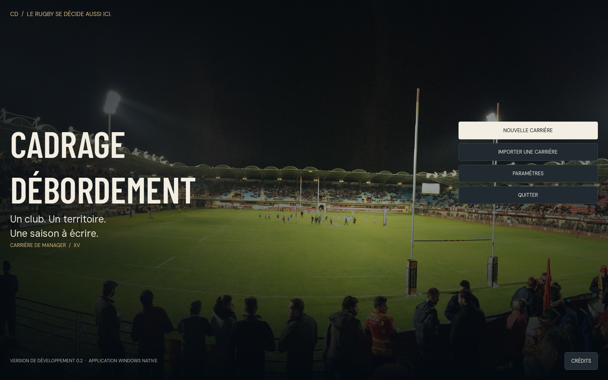
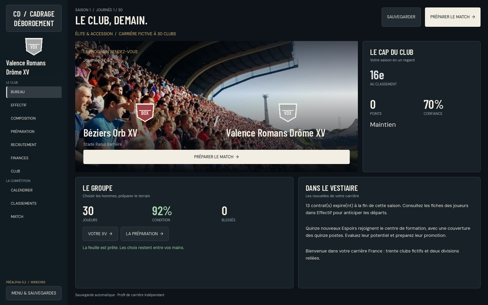
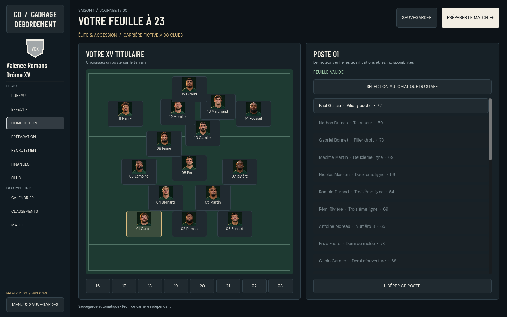
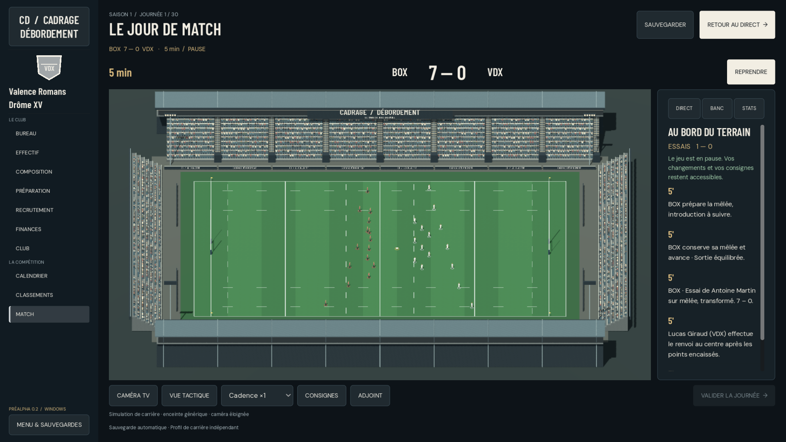

# Godot 0.2 — carrière et direction artistique

Réception du 7 novembre 2026. Version Windows native de développement, construite depuis le code `6b3f7e2e1cd37520d385c7c4151d5642dba840c8`, sur le main qualifié `712d0254ef738c1367fda486f8428d5a2569d1a8`. La documentation ajoutée ensuite ne change pas l'exécutable reçu. La qualification GitHub du dernier HEAD reste une preuve distincte, à consulter sur la PR ; aucun résultat CI futur n'est compté réussi ici.

## Ce qui devient jouable

Accueil et création explicite de carrière, trente clubs fictifs dans deux divisions reliées, saisons régulières de 26 et 30 journées, phases finales et barrage d'accession. Une saison comprend 433 rencontres simulées avec les effectifs et le moteur existants. Les montées/descentes conservent les IDs des clubs ; les saisons suivantes sont accessibles dans le jeu.

Dix vues de gestion : Bureau, Effectif et fiches, Composition à 23, Préparation, Recrutement, Finances, Club, Calendrier, Classements, Match. Les offres affichent salaire, durée et frais ; une contre-offre ne recrute aucun joueur. Charges individuelles, entraînement, tactiques et substitutions passent par les contrôleurs natifs. Les pénuries de sélection disposent d'une promotion de secours confirmée et payante. Les indisponibilités sont refusées visiblement.

La direction artistique utilise Barlow Condensed et DM Sans, anthracite/ivoire et couleurs du club, photographies des territoires et portraits fictifs légendés. Le stade générique reçoit pelouse nuancée, tribunes à travées, silhouettes décoratives et enseignes originales CD. Les joueurs, couleurs et ballon restent ceux de la trame native. Caméras TV et tactique gardent le terrain entier.






## Réception exécutée

Machine de réception : Windows, Godot 4.7.2 officiel, GL Compatibility/OpenGL 3.3, NVIDIA RTX 4080 SUPER ; runtime Node Windows 26.13.0 embarqué. Aucune commande de souris, clavier système ou activation d'une fenêtre utilisateur. Les contrôles et captures utilisent les API internes de nos instances Godot.

| Contrôle | Résultat constaté |
|---|---|
| Trente créations France, partitions 14/16, calendriers, classements et transitions | Suites France ciblées réussies ; ancienne fiction14 et LNR14 identiques à la référence appariée |
| Campagne moteur de dix saisons, avec validation et export/import aux transitions | 4 330 rencontres ; sauvegarde maximale 2 649 706 octets UTF-8 / 216 372 nœuds ; plafonds France 400 000 nœuds / 5 Mio |
| UI Windows depuis le projet, après correction des contrôleurs | 488 contrôles réussis ; saison 2, club 29, offre signée, deuxième match et réimport reçus |
| Régressions finales du SDK sur la source intégrée | 219 contrôles, dix modes, aucun skip : disque, UI, limites, transport, récupération, décisions rapides, tactiques, banc, modales, focus |
| Ancien profil14 issu du ZIP précédent | 16 contrôles graphiques Windows ; match en cours repris jusqu'à la journée suivante, sans conversion ; original conservé |
| Même profil14 dans le moteur réellement embarqué | Indice `round` 1 → 2 et export réussis avec le Node du ZIP, PATH sans Node installé |
| Stade natif isolé | 127 contrôles graphiques Windows ; six cadrages, présence 30 → 29 → 0, ballon, couleurs et modèle ; déterminisme séparé réussi |
| Cycle de scène utilisé par l'UI | Trois reconstructions consécutives, anciens conteneurs libérés, nouvelles présences exactes et journaux propres |
| Exécutable release extrait et déplacé | **500/500 contrôles réussis**, deux résolutions 1440×900 / 1920×1080, saison 2 / club 29, export et réimport |
| Autonomie du ZIP déplacé | 62 fichiers du manifeste vérifiés ; jeu + Node embarqué observés, zéro orphelin, zéro connexion TCP observée |
| Redémarrage du moteur embarqué sur le profil France reçu | Club29 / saison2 / modeFrance30 retrouvés ; simple snapshot sans changement du fichier sauvegardé |

Les premiers essais ayant échoué ne sont pas comptés verts : sélection IA incomplète après blessure, conséquences D2 ou éliminatoires, commandes rapides, cache du banc et dimensions des dialogues ont été reproduits puis corrigés avant cette réception. Les imports hostiles, écritures refusées et décisions périmées conservent les garanties de rollback ; le profil corrompu est copié octet pour octet avant récupération explicite.

## Archive et construction

Archive reçue : `CadrageDebordement-PrototypeGodot-Windows-x64.zip`, **177 788 180 octets**.

SHA256 : `e11bcde4ff24c22b38aa966ae31b115cec7827e90e0fe624c338f406eaee44c5`.

Décompresser le dossier complet puis lancer `CadrageDebordement.exe`. Les carrières sont dans `%APPDATA%\CadrageDebordement\PrototypeGodot`, indépendamment de l'exécutable. Le menu conserve import/export et reprise ; aucun lancement ne crée une carrière automatiquement. L'ancien profil fictif14 reste indépendant d'une nouvelle France30. Les crédits et licences des photos, polices, modèle, Godot et Node accompagnent l'archive.

Construction reproductible à partir des ressources suivies :

```text
python scripts/build-godot-prototype.py --sdk CHEMIN_SDK_GODOT_WINDOWS_4.7.2 --node CHEMIN_NODE_WINDOWS --output NOUVEAU_DOSSIER
```

Le script ne télécharge rien et refuse une sortie existante. Il importe le projet, exporte le PCK dans le .exe, copie les 43 modules et contrôleurs requis, le Node embarqué et les licences, puis calcule le manifeste et l'archive. `--stage-only` prépare uniquement les ressources du projet.

Les preuves locales sont conservées dans le dossier de travail `CD` : `godot-native-qa/godot-career-v2-final01/` pour le ZIP, `v2-final-native-regressions.log`, `v2-legacy14-ui03/`, `v2-stadium-reception/run01/` et les rapports de revue du chantier. Les captures ci-dessus proviennent de l'exécutable exact reçu, pas d'une maquette.

## Choix et limites

- Le lot poursuit Godot et le moteur JavaScript partagé. Il ne charge pas la BDD Rugby Réel et n'active pas France30 dans la page web. Une préférence artistique différente coûterait une reprise de l'interface, sans imposer une réécriture des sauvegardes.
- Les tâches d'implémentation moteur, UI puis stade ont été sérialisées, avec revues indépendantes ; ce choix évite les écritures concurrentes dans les raccordements et coûte du délai par rapport à des tâches entièrement parallèles.
- Les promotions sont de vrais joueurs qualifiés avec coût salarial, jamais un contournement de la feuille. Un choix inadapté engage donc la masse salariale ; les montants sont annoncés avant confirmation.
- Une décision peut attendre un tick ; une seconde décision métier doit attendre sa réponse ou reçoit un refus visible. Cela évite les choix périmés et les actions perdues, au prix d'un nouveau clic après acquittement.
- Un World3D isolé est conservé par viewport. Le diagnostic de deux stades simultanés dans le même World3D a signalé deux textures GL non libérées à la fermeture ; ce cas n'est pas celui de l'UI reçue. Une future superposition demanderait de reprendre cet audit. Le parcours réel, ses trois reconstructions et l'exécutable n'ont pas ces messages.

Le format de compétition 2026–2027 est séparé du profil historique des lois de match. Monde fermé sans Nationale, cadence de 34 semaines, tirs atomiques et buteurs automatiques sont déclarés. Drops, cartons de staff et forfaits administratifs ne sont pas couverts intégralement. Le stade est générique, le public statique et les photographies sont des archives ; aucune météo dynamique ou reconstruction des trente enceintes n'est annoncée. Les budgets, joueurs et objectifs sont fictifs.

Cette réception n'est ni une publication Steam, ni une certification des autres GPU, ni une validation de l'ensemble des lois du rugby. Les autres systèmes web tardifs non chargés par le worker ne sont pas annoncés disponibles dans cette préalpha.
