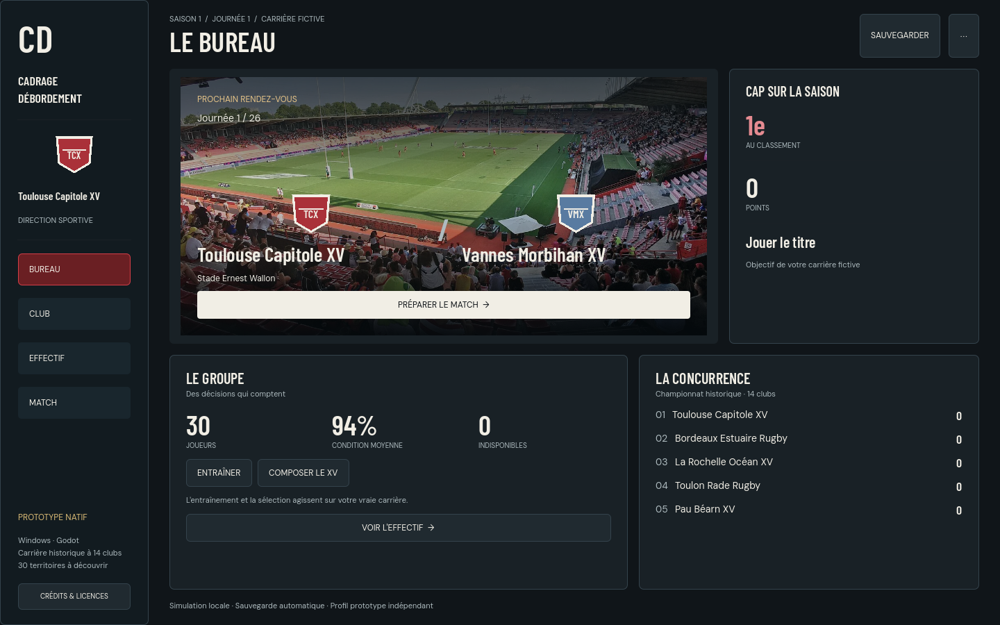
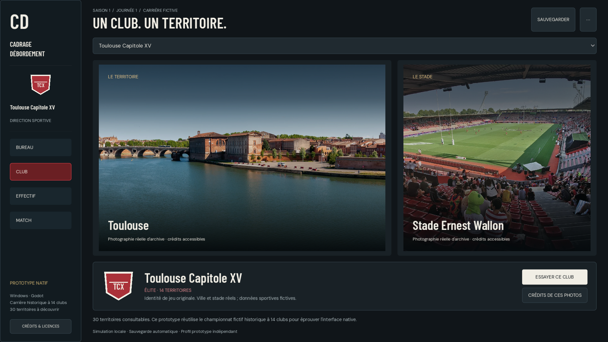
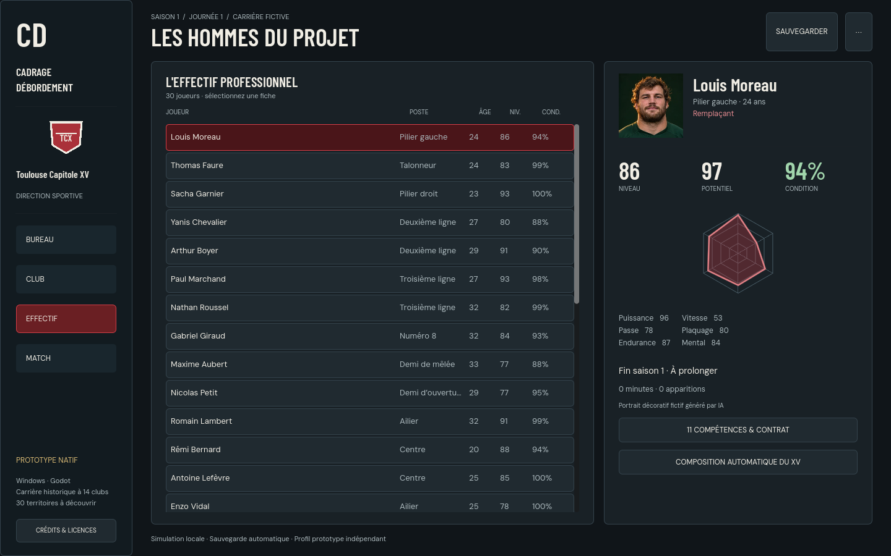
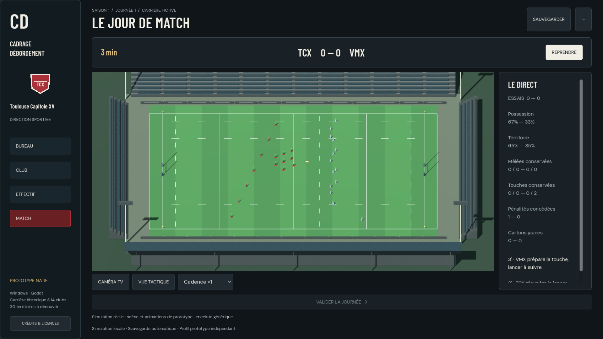

# Cadrage Débordement — prototype Godot Windows natif

Décision de Léo : éprouver Godot avant de poursuivre le portage commercial Steam et la carrière reliée à trente clubs. Le prototype est une application Windows x64 avec UI Godot native, pas une fenêtre Chrome, Edge ou WebView. La version web et ses carrières existantes sont conservées.

## Ce que l'on peut essayer

- Bureau : prochain match, état du groupe, classement, entraînement et composition automatique réels.
- Club : trente territoires, identités de jeu originales, photo de ville et de stade, quatorze clubs historiques essayables.
- Effectif : sélection d'une fiche, portrait décoratif fictif, attributs, radar, condition, contrat et composition.
- Match : simulation historique réelle, terrain Godot, modèles/animations existants, caméras TV et tactique éloignées, pause/reprise et validation de journée.
- Sauvegarde automatique et manuelle, export/import JSON natifs, profil séparé. Une importation reprend les contrôles de validation du moteur ; les modes BDD réelle et France30 sont refusés dans cette épreuve.

L'architecture du moteur historique reste à **14 clubs**. Les trente clubs ne sont **pas encore une carrière complète à deux divisions** : leur catalogue et leur atlas sont prêts, le chantier des montées/descentes conserve son plan séparé et attend la réception du prototype. Le protocole de cette épreuve ne propose pas encore tous les centres métier, les transferts ou le passage à la saison suivante. Aucune publication, vente ou intégration Steamworks n'est revendiquée.

## Direction artistique

Anthracite, ivoire, couleurs du club ; titres Barlow Condensed, données DM Sans, blasons originaux et silhouettes lisibles. Le prochain rendez-vous domine le Bureau ; le Club montre son territoire ; l'Effectif garde le tableau et une fiche simultanément visibles. Images et contrôles sont des ressources locales. Les photographies sont des archives réelles ; l'enceinte 3D demeure générique, sans foule ni reconstruction des trente stades. Les animations CC0 réutilisées ne constituent pas une nouvelle simulation de contacts.









## Données et droits des ressources

`dist/france-clubs.js` contient trente identités de présentation indépendantes, IDs stables et partitions 14/16. Il ne modifie ni les identités sauvegardées des anciens modes ni une BDD Rugby Réel. La correspondance historique/BDD réelle est explicite et testée ; les seize autres clubs ne sont pas instanciés par le moteur de ce prototype. Les paramètres de puissance/trésorerie du catalogue restent fictifs.

60 photographies WebP avec source, auteur, licence, modifications et empreintes du fichier source et du dérivé : [crédits complets](club-atlas-credits.md) et `dist/assets/club-atlas/manifest.json`. 58 sources Wikimedia Commons et deux orthophotographies IGN. Les panoramas conservent davantage de hauteur utile, jusqu'à 4000 px de large, sans déformation ; les autres images sont limitées à 1600×1200. Les restrictions supplémentaires publiées par les sources sont conservées. Il ne s'agit pas d'une certification de tous les droits nécessaires à une commercialisation. Aucun asset du skin FM ni pack Sortitoutsi n'est incorporé.

Le ZIP contient les notices Godot/MIT et ses dépendances, Node, fontes/OFL, modèle Quaternius/CC0, crédits et manifeste des photos. Les portraits sont les assets fictifs existants générés par IA, pas les visages des joueurs réels.

## Architecture et stockage

`native/godot/` : fenêtre, Control/Theme, vues et scène3D. `native/engine/` : processus Node embarqué chargeant explicitement 39 modules sportifs/gestion/sauvegarde existants de `dist/`, sans harness de tests, navigateur, port HTTP ou BDD réelle. Messages JSON lignes privés sur stdin/stdout ; seuls les verbes bornés du protocole sont acceptés. Les pipes bloquants sont servis par threads, pas sur le thread UI. Les positions proviennent de `CDMatch3DAdapter.normalize(matchScene(S.live))`, sans trajectoire sportive inventée.

Profil normal : `%APPDATA%/CadrageDebordement/PrototypeGodot`, **hors dossier de l'exécutable**, sans repli silencieux. Les mutations sont validées puis confirmées sur disque avec remplacement atomique et copie précédente. Un échec restaure l'état/RNG précédent et reste visible. Le verrou de profil vérifie son propriétaire ; un garde d'acquisition abandonné est refusé explicitement. Le jeu ne supprime pas automatiquement ce garde sur une hypothèse de PID mort. La fermeture termine uniquement son moteur enfant.

## Construire et contrôler

```powershell
# Node et SDK sont fournis explicitement au constructeur, pas installés par lui.
python scripts/build-godot-prototype.py --stage-only --node 'C:/chemin/node.exe'
python scripts/build-godot-prototype.py --sdk 'C:/chemin/golden-godot-sdk' --node 'C:/chemin/node.exe' --output 'C:/nouvelle-sortie'
```

Le constructeur ne télécharge rien et refuse une sortie existante. Il vérifie les empreintes des soixante photos, prépare les ressources ignorées dans `native/godot/assets`, importe et exporte sur une copie, embarque Godot/PCK, Node et uniquement les modules autorisés. Chaque distribution comporte un manifeste SHA256 et une notice. Le joueur extrait le ZIP entier et lance `CadrageDebordement.exe` ; rien à installer.

Réception automatisée du **même exécutable exporté**, sans souris : définir `CD_GODOT_SELF_TEST=1`, `CD_GODOT_DATA_DIR` vers un **profil temporaire jetable**, `CD_GODOT_QA_CAPTURES` vers un dossier de résultats, puis lancer l'exécutable. Ce mode de test borné n'est pas un écran joueur et refuse l'absence de profil explicite. Pour le projet source, `tests/godot-ui.gd` lance le même pilote. Les tests remplacent volontairement leur carrière jetable ; ne pas leur donner un profil personnel.

## Réception constatée le 7 novembre 2026

- Catalogue/provenances/fontes/modèle : quatre tests Node réussis, 60 empreintes et crédits vérifiés.
- Pont : parité avec le moteur direct, snapshots sans RNG ni écrit, match complet, commandes invalides, imports, sauvegarde/reprise, disque réellement refusé et rollback. Régressions sauvegardes/rugby/actions/2D/adaptateur exécutées par le producteur. Revue indépendante I1/I2 corrigée : disposition exportée et confinement physique, acquisition concurrente d'un verrou périmé, propriétaire au nettoyage ; EOF du processus remonté sans erreur de parseur Godot.
- 3D : présences 30→29→0, ballon seulement avec une trame, payload inchangé, interpolation/convergence, clips existants, quatre coins cadrés par les deux caméras. Revue indépendante conforme/approuvée.
- UI Windows réelle : **115 contrôles**, quatre vues à 1440×900 et 1920×1080, taille exacte des captures, deux accents de club, nom long, entraînement, composition, match/pause/fin, journée suivante et deuxième coup d’envoi sans changer de vue, export écrit/import repris. Captures réellement examinées. La revue finale a également fait corriger la création répétée après refus disque, le bouton du match suivant, la terminaison du transport sur réponse sans ID et la cadence affichée après navigation : 32 contrôles runtime et six contrôles de bornes/import réussis, puis re-revue favorable. Limites cohérentes de 5 Mio de texte UTF-8 et 6 Mio pour le message encodé. Les premiers échecs de démarrage sans carrière, de géométrie à1920, de débordement du panneau statistique et d'attente de fermeture ont été corrigés ; aucun échec initial n'est compté réussi.
- Même parcours **115/115 dans le release `.exe`** avec Node embarqué, puis dans le ZIP extrait sous un autre chemin comprenant espaces et accent, PATH réduit à Windows/System32, variable Node retirée. Processus observés : `CadrageDebordement.exe` et son `runtime/node.exe` ; aucune connexion TCP observée, aucun processus orphelin après arrêt. Les 57 fichiers du manifeste de distribution sont vérifiés ; le runtime embarqué reprend ensuite le profil au tour1 et un snapshot laisse son empreinte disque inchangée. Contrôle réalisé sur Windows/OpenGL3.3/RTX4080SUPER ; aucune garantie de performances iGPU ou certification Steam Deck.

Mesures publiques sans chemins personnels : [réception JSON](godot-captures/reception.json). ZIP reçu : 177721025 octets ; SHA256 `78c6ae3580fdebbd5ec2ecb5aac67e24189469b87f223f0f085e8000de6e995f`. L'archive est une épreuve native locale, pas une release Steam. CI distante et intégration GitHub sont à constater sur le dernier SHA publié ; les preuves locales ne les remplacent pas.

