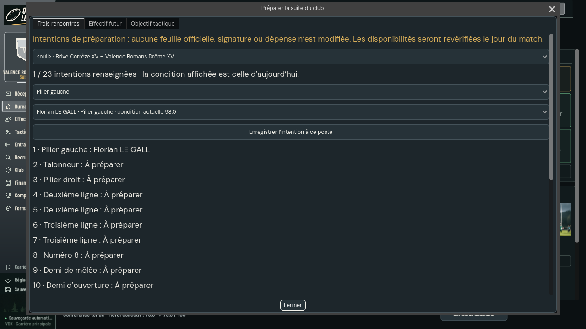
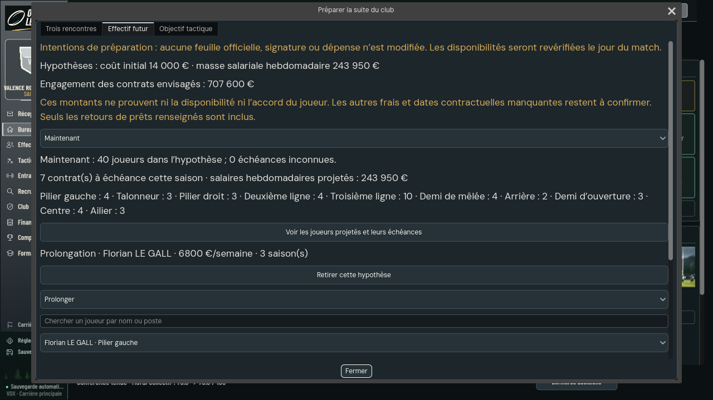
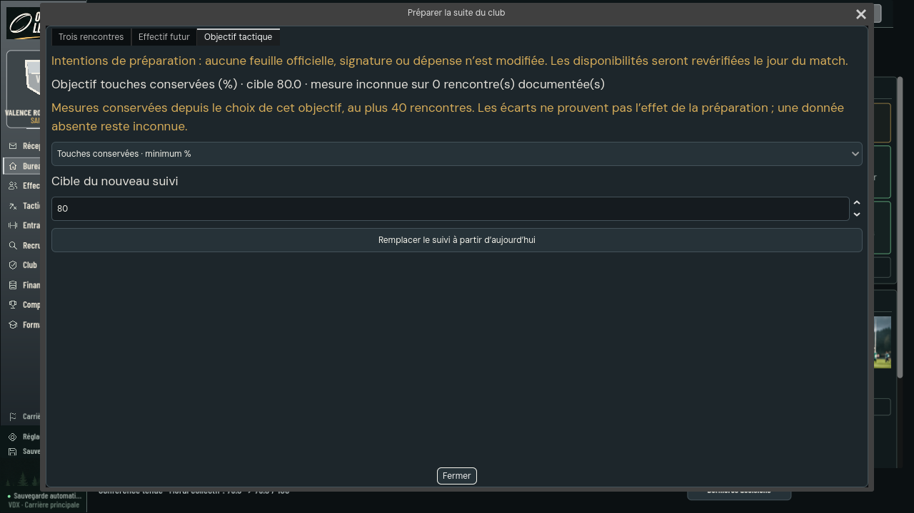
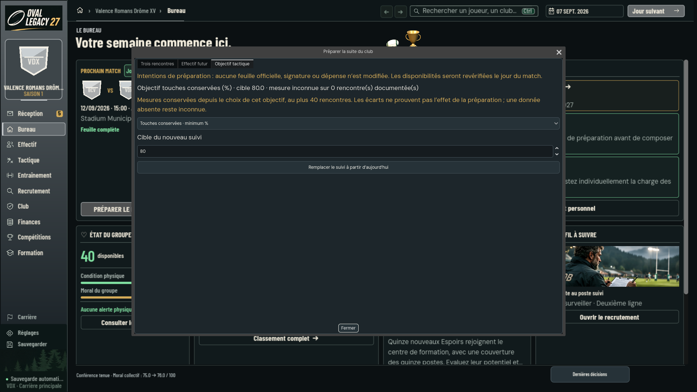

# Fluidité et atelier de préparation du manager

Lot du 12 novembre 2026, depuis main `3cc02a337c4bf02153b6c2401ed847ffcdee060b`.
Autorisation de Léo : réduire les réponses du moteur et réaliser les trois
ajouts proposés dans l'audit. L'économie #552/#589, désormais intégrée, reste hors des modifications de ce lot.

## Ce que le manager peut faire

« Préparer la suite du club », depuis le Bureau ou Préparation, ouvre trois
parcours dans une fenêtre adaptée à la taille disponible :

- **Trois rencontres** : consulter les trois prochaines rencontres publiées,
  préparer 23 intentions par rencontre parmi les joueurs qualifiés, lire
  blessures actuelles, sélections confirmées et engagements de minutes.
  Une composition provisoire ne devient jamais la feuille officielle.
- **Effectif futur** : consulter l'effectif maintenant, à la fin de la saison
  et la saison suivante, ses postes, échéances et retours de prêts renseignés.
  Comparer jusqu'à huit hypothèses de prolongation, recrutement et promotion.
  Les hypothèses affichent coût initial, masse salariale hebdomadaire et
  engagement des contrats envisagés. Aucune signature ni dépense n'est appliquée.
- **Objectif tactique** : démarrer un suivi de touches ou mêlées conservées,
  ou de pénalités concédées. Les rencontres documentées après ce choix
  apportent leurs mesures et leurs événements détaillés lorsqu'ils existent.
  Une donnée absente reste inconnue ; un écart ne prouve pas une causalité.

Les intentions sont conservées par identifiants dans `S.managerPlanning`,
avec validation stricte à l'import. Elles sont isolées par saison et club.
L'absence de cette rubrique reste acceptée. Aucun vrai nom n'est ajouté par
ces intentions ; la présentation utilise les identités du modèle public.

Les scénarios démarrent pendant la saison courante : une durée d'une saison
finit cette saison (`season + years - 1`), selon la convention actuelle du jeu.
La fin de saison montre encore les contrats qui arrivent à échéance ; la
saison suivante les retire, sauf hypothèse qui les couvre encore. Prolonger
un joueur en prêt entrant ne constitue pas un transfert de propriété et n'est
pas proposé. Les prix et durées saisis restent des hypothèses à revalider.

## Fluidité : transport de main et cache de lecture

Le transport différentiel est déjà livré dans main par #613 : `model-delta.cjs`
et son récepteur dans `engine_bridge.gd` utilisent `base/patch`. La convergence
avec main du 13 novembre conserve intégralement ce protocole, son instrumentation
et les optimisations de projection de Claude. L'encodeur/récepteur non livré
initialement proposé dans #588 est retiré ; il n'y a pas deux transports empilés.
Les trois outils manager utilisent le pont public courant.

L'ajout propre à ce lot est le cache des projections VM pour les seules lectures
`snapshot`. Chaque lecteur reçoit une copie indépendante. Toutes les autres
commandes, y compris refusées, invalident le cache ; les reçus transitoires ne
survivent pas à leur commande. La présentation des packs et la frontière des
connaissances restent appliquées avant de publier le modèle.

### Mesures historiques du prototype

Le [relevé initial](manager-planning-20261112/performance.json), effectué avec
Node24.22.1 sur une carrière commune club29/graine27, comparait un modèle de
5 515 185 octets à une réponse négociée inchangée de115 octets ; calcul moteur
chaud228–271 ms contre512–549 ms sans cache. Ce relevé décrit le prototype
précédent et **ne mesure pas le transport de main #613**, ni le cumul actuel.
Il ne constitue pas une recette Windows. Aucun nouveau gain chiffré n'est
revendiqué après convergence ; le comportement du cache est vérifié sur le
worker courant (lectures pures, copies indépendantes et invalidation).

## Réception

### Convergence avec main le 13 novembre

Après le passage au mode Monde unique (#637), un test de carrière `world-champ`
avec les anciens modes désactivés vérifie les trois intentions et l'invariance
du reste de la sauvegarde. Les fixtures historiques déclarent explicitement
`CD_MODES_HERITES=1` ; ce réglage reste réservé aux tests. Le registre des domaines
de main est conservé, puis `managerPlanning` est enregistré séparément pour éviter
les conflits récurrents lors de l'ajout de domaines par les autres branches.

Le cumul avec main `204eaabf`, dont #613, passe 10 tests moteur/cache et
3 tests Godot (deux parcours de l'atelier et le vrai pont de main), sans saut.
Le test du cache échoue sur main avant ajout, puis passe après raccordement.
Le protocole, le panneau de chargement, l'instrumentation et la mémorisation
par projection de #613 restent ceux de main. Les domaines JIFF et indemnités
de formation sont conservés dans le manifeste. Aucun champ économique,
profil de joueur, règle de match ou donnée figée n'est modifié par ce lot.

### Historique des recettes initiales

- Régressions moteur ciblées : **26 contrôles réussis**, aucun ignoré :
  décisions, délégation transactionnelle, connaissances des joueurs, copies
  de sécurité/imports, presse, finances et calculs de transfert, ainsi que
  les premiers contrôles du nouveau lot.
- Après les corrections de revue : **17 contrôles ciblés réussis**, aucun
  ignoré (projections, worker réel, reprise/import et vrai stdio).
- Godot4.7.2 Linux : navigation **155/0**, priorités du Bureau **107/0**.
- Atelier complet, vrais menus → vrai pont → vrai worker : **34/0**, avec
  commandes d'intention, comparaison de l'état canonique et géométrie à
  1280×720 et1920×1080. Captures X11/llvmpipe ci-dessous.
- Recettes initiales de composants Godot : réassemblage du prototype retiré et parcours du dialogue,
  sans erreur de script ; la fixture du dialogue est une vraie carrière.
- Stage des ressources et contrôles de données existants exécutés ; aucune
  donnée du jeu ou ressource de Gabi n'est versionnée dans ce lot.

Ces comptes sont ceux de bancs distincts et se recouvrent ; ils ne sont pas
additionnés en un total de couverture. Les journaux complets restent dans
`/workspace/work/manager-planning-evidence-20261112` pendant cette session.
La CI de la PR et la réception Windows sont des vérifications séparées.

## Revue et décisions

Une revue indépendante a relevé quatre problèmes importants : parent vide
résiduel après suppression, qualifications non revérifiées à l'import,
échéance contractuelle décalée d'une saison et prolongation d'un prêt entrant.
Ils ont été reproduits par des tests rouges puis corrigés. Les tests d'import
recalculent le checksum pour atteindre réellement les validateurs de domaine.
Les devis de prolongation et le retrait d'hypothèses périmées ont également été
corrigés. La réception graphique a révélé le typage flottant des nombres JSON
Godot : la comparaison des numéros de poste est désormais explicite.

Décisions prises :

- Cache limité à `snapshot`, pour éviter une projection périmée pendant une
  commande qui vérifie puis modifie l'état. Coût : les commandes modificatrices
  ne bénéficient pas de ce cache de lecture.
- Hypothèses contractuelles au départ de la saison courante, avec la même
  convention d'échéance que le moteur. Les engagements différés ne sont pas
  modélisés dans ce premier lot.
- Conservation des intentions dont la source a disparu, avec motif et retrait
  possible ; elles sont exclues des totaux. Aucun joueur absent n'est recréé.

## Limites

Pas d'installation sur PC pro ou personnel, pas de recette Windows, pas de
nouvelle qualification de longue carrière sur toutes les éditions. Le premier
modèle reste volumineux ; pagination et chargement des dossiers à la demande
restent des améliorations possibles. Les événements historiques absents ne
sont pas inventés. Le suivi tactique utilise la rétention déjà disponible,
au plus40 rencontres, dans la saison et le club courants. Les frais non saisis,
les revenus futurs et les décisions de recrutement non confirmées ne sont
pas des engagements financiers réels.

Les anciennes carrières personnelles de Léo sont des tests ; aucune migration
de ces parties n'est demandée. Les scénarios de compatibilité restent des
vérifications du moteur, sans exigence de conserver son ancien pack.
