# Gestes de rugby dans le match 3D — 11 novembre 2026

Seconde moitié de la « tranche de démonstration » : une touche, un ballon porté,
un essai, reconnaissables sans légende. Branche `claude/tranche-demo-match-20261111`,
partie de `fe79c365` (tête de la PR 539).

## Ce qui est fait

Trois gestes, tous déclenchés par des faits que le moteur produit déjà. Rien
n'est décidé côté Godot : ni vainqueur, ni porteur, ni marqueur, ni point de ballon.

| Geste | Fait du moteur qui le déclenche | Ce que l'on voit |
| --- | --- | --- |
| Touche avec porteurs | scène `lineout` (alignement), puis `setpiece-win` ou `setpiece-loss` dont l'origine est une touche | Deux lignes séparées par un couloir entre les 5 et les 15 mètres, talonneur en touche ballon au-dessus de la tête, lancer vissé, deux blocs de saut portés, prise à deux mains par l'équipe que le moteur désigne, bloc adverse battu |
| Ballon porté | même fait `setpiece-win`, combinaison `maul` du carnet de jeu | Le sauteur redescend, le ballon passe à l'arrière, les avants se lient buste engagé, trois adversaires s'opposent, le regroupement avance jusqu'au point de ballon du moteur |
| Essai aplati | scène `try` | Le marqueur désigné par le moteur se détache, plonge bras tendus, ballon posé au point d'essai du moteur ; ses partenaires lèvent les bras. Hors ballon porté, le marqueur plonge seul et les trois partenaires les plus proches lèvent les bras |

Le match attend la fin d'un geste avant de demander l'action suivante, par le
mécanisme qui existait déjà pour la passe longue (`is_presenting_extended_pass`).

Pendant un geste, la caméra du jeu (TV par défaut et « action ») se rapproche en
douceur et cadre ce qu'il faut lire, puis revient à son cadrage normal : touche,
les deux lignes et le lanceur ; ballon porté, le groupe et l'espace devant lui ;
essai, le marqueur et l'en-but. La caméra TV pivote aussi de 20°, lentement, pour
ne plus voir la ligne de touche dans son axe. Détails dans « Cadrage pendant un geste ».

### Captures avec les caméras du jeu (recadrage pendant le geste)

Toutes ces images sont rendues en 1920×1080 par la vraie vue de match, caméra
du jeu sans aucun réglage de contrôle. Séquence rejouée : un vrai match simulé
(club 2 du harnais de test, 76e minute) : sortie en touche, alignement,
« ECA conserve sa touche · Ballon porté », « Essai de Lucas Faure sur ballon porté »,
renvoi.

Avant / après, mêmes instants du geste (ligne du haut : commit `4b18e926`,
ligne du bas : ce lot) :

- caméra TV (par défaut) : 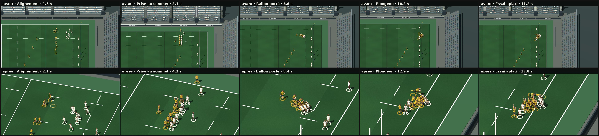
- caméra « action » : 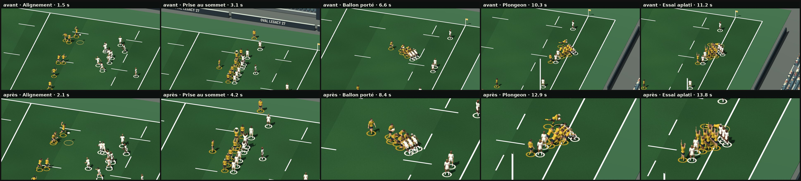

Séquences, une image toutes les 0,9 s environ, de l'alignement au renvoi :

- caméra TV : 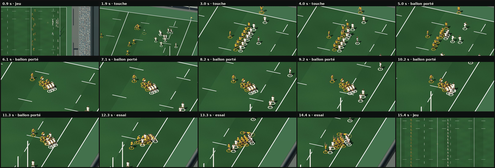
- caméra action : 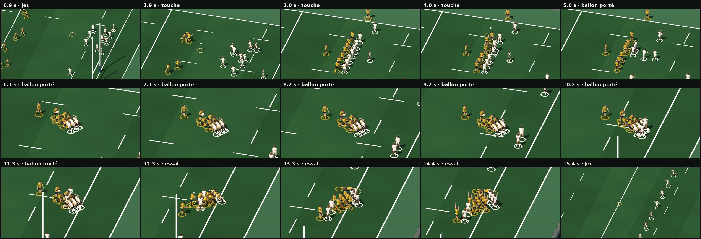

Images pleine définition :

| | Caméra TV | Caméra action |
| --- | --- | --- |
| Prise au sommet | 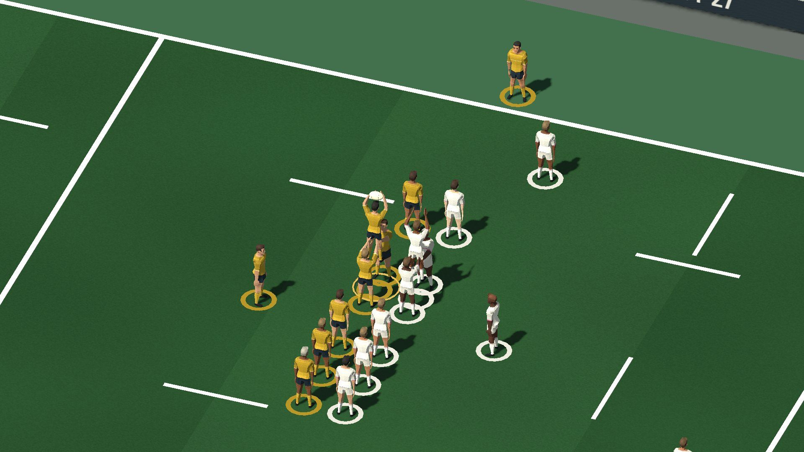 | 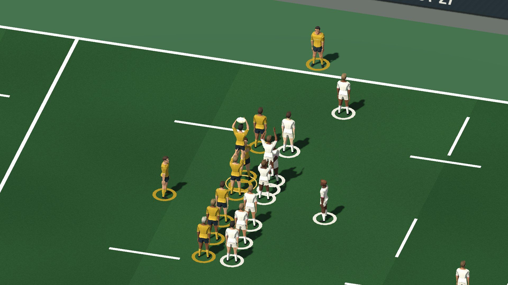 |
| Ballon porté | 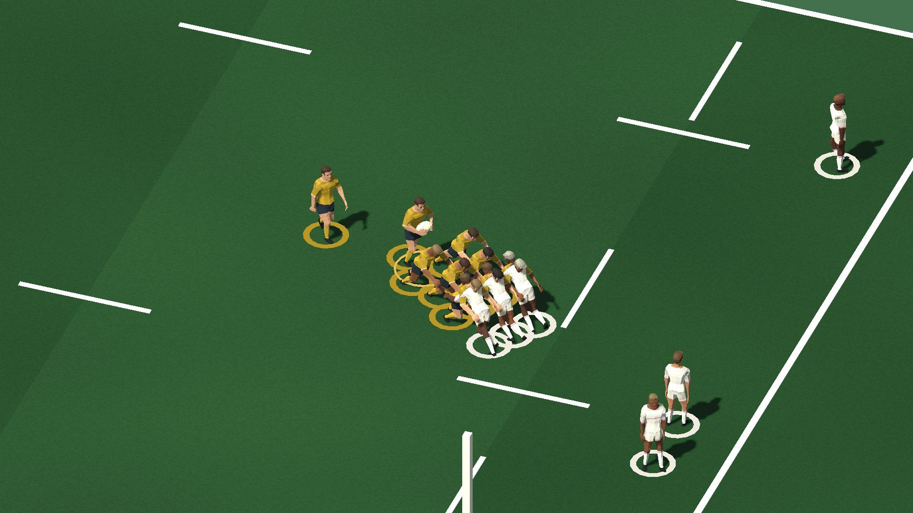 | 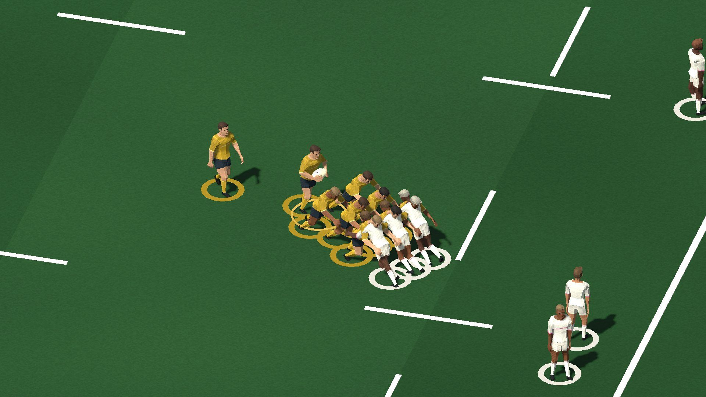 |
| Essai aplati | 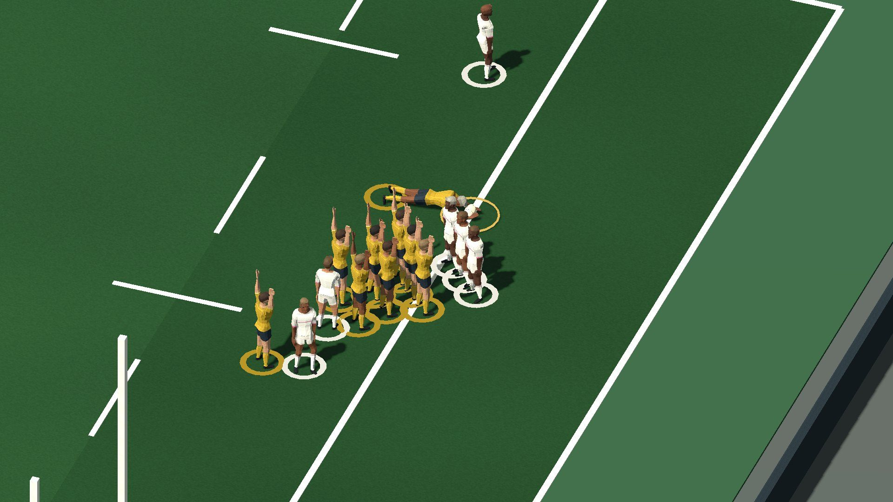 | 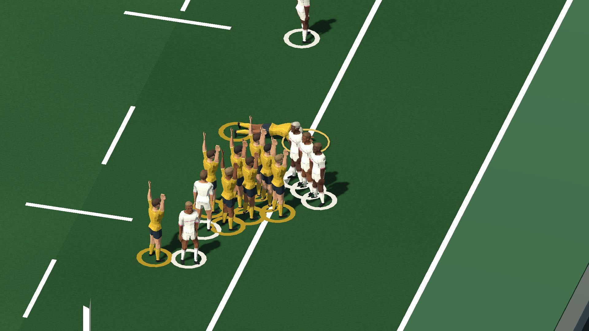 |

Vue rapprochée (outil de contrôle, 8 m de hauteur visible, ce n'est pas un réglage
du jeu). Seule l'image du ballon porté est refaite dans ce lot (nouvelles jambes,
6 m de hauteur visible) ; les autres datent du lot précédent : poses inchangées,
rythme d'avant.

| | |
| --- | --- |
| 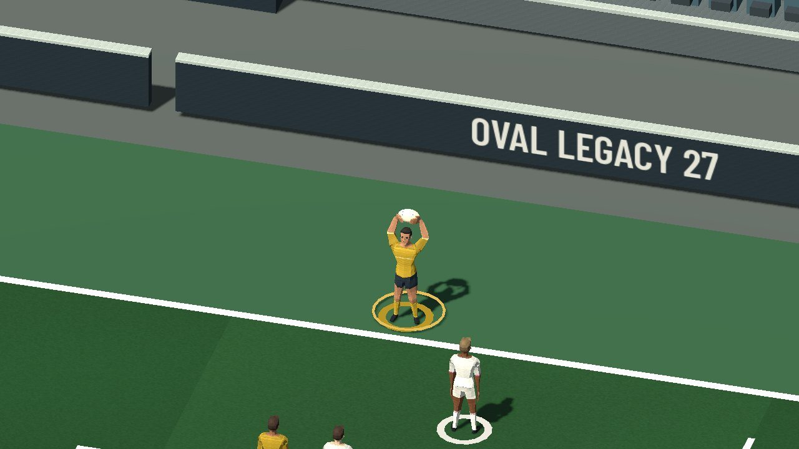 | 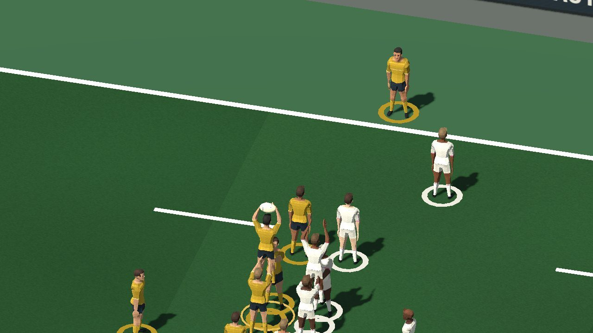 |
| 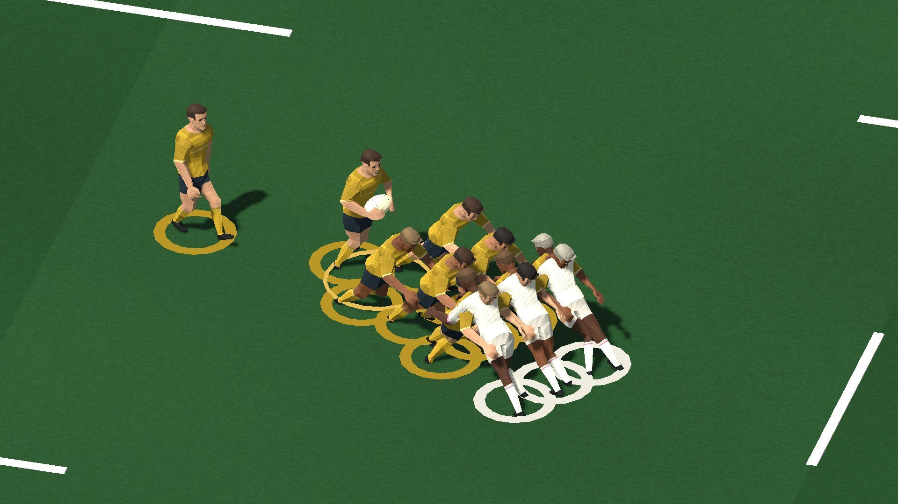 | 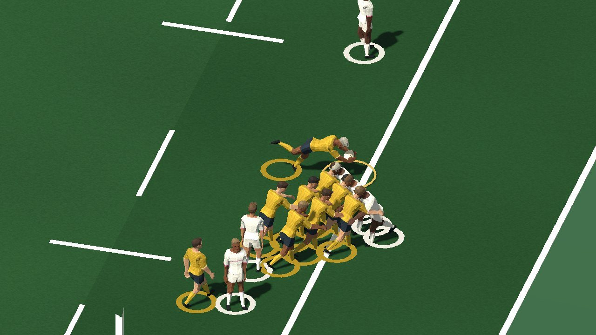 |
| 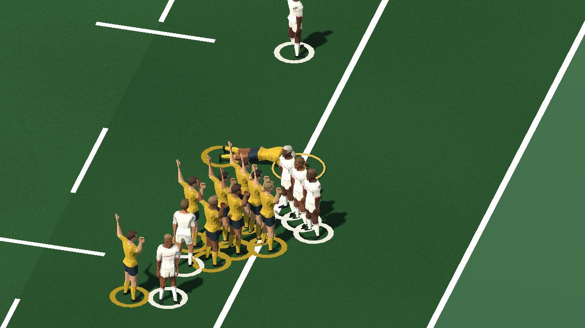 | 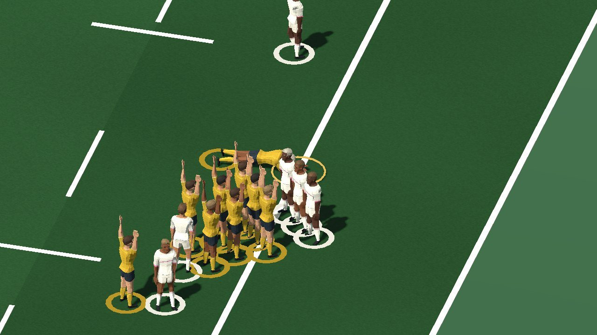 |

Séquences rapprochées du lot précédent (rythme d'avant) : [touche](match-gestes-20261111/sequence-touche-rapprochee.jpg),
[essai](match-gestes-20261111/sequence-essai-rapprochee.jpg). Comparaison sans
les gestes : [la même touche conservée](match-gestes-20261111/00-sans-gestes-touche-conservee.jpg).

### Lecture critique

Avec les caméras du jeu, sans vue rapprochée :

- **Touche, caméra TV** : avant, deux colonnes de points et rien d'autre. Après,
  on lit une touche sans hésiter : lanceur en touche, deux lignes, sauteur porté
  bras tendus au-dessus de la ligne, ballon en l'air, bloc adverse qui conteste.
  Le léger pivot de la caméra (20°) y est pour beaucoup : vue de face, la ligne
  s'alignait sur l'axe de la caméra et le saut se confondait avec elle. Les mains
  des porteurs restent difficiles à distinguer.
- **Touche, caméra action** : gain modéré (11,7 m de hauteur visible contre 16,
  et l'alignement centré au lieu du ballon). Le geste y était déjà reconnaissable ;
  sauteur, porteurs et bloc adverse se lisent maintenant sans effort. Pour garder
  les deux lignes et le lanceur (15 m de long), la caméra ne peut pas se rapprocher
  davantage.
- **Ballon porté** : net gain dans les deux caméras (11 m de hauteur visible en TV,
  9 m en action) : porteur à l'arrière ballon contre lui, pousseurs penchés jambes
  fléchies, adversaires liés en face. On lit un maul, plus seulement un bloc.
- **Essai** : plongeon, joueur allongé sur la ligne, partenaires bras levés : lisible
  en TV comme en action. Le marqueur est en partie masqué par les défenseurs restés
  debout contre le regroupement.
- **En caméra TV, le recadrage rapproche la vue de celle de la caméra action** :
  c'est voulu (c'est la distance où les postures se lisent), mais pendant un geste
  les deux caméras se ressemblent.
- **Mise en place** : les joueurs proches (moins de 15 m) rejoignent l'alignement
  en 1,2 à 2 s à allure de course (pointe 9 m/s au plus). Mais dans cette séquence,
  six avants de l'équipe qui lance partent de positions schématiques du moteur
  situées de 19 à 42 m de l'alignement (ligne défensive étalée sur toute la
  largeur) : ils traversent encore le terrain beaucoup trop vite (environ 26 m/s
  en pointe, contre 69 m/s avant). Ce n'est pas réglable proprement côté
  présentation sans allonger fortement l'attente ; voir « Prochaine étape ».
- **Jambes du ballon porté** : petits pas d'appui plantés en arrière du bassin, genoux
  fléchis, bassin abaissé. Mieux que la marche raide, et lisible à distance ; en vue
  rapprochée, les adversaires gardent les jambes assez tendues vers l'arrière et le
  porteur marche encore presque droit. Ce sont des poses calculées, pas une
  animation de poussée capturée.
- **Renvoi après l'essai** : le ballon part au centre à 100 m/s ; la caméra d'origine
  y fait déjà un panoramique très rapide. Le recadrage cède alors aussitôt la place
  à la caméra d'origine (coupe) au lieu de mêler son retour à ce mouvement, ce qui
  aurait donné un panoramique encore plus rapide en vue rapprochée.

## Comment c'est fait

- `native/godot/match_gestes.gd` (nouveau) : toute la logique. Poses procédurales
  sur le squelette du modèle CC0 déjà livré (inclinaison du corps, flexion du
  buste, bras par le solveur à deux os existant de `match_presentation.gd`).
  **Aucune ressource ajoutée, aucun téléchargement.**
- `native/godot/match_view.gd` : une quarantaine de lignes de raccord, toutes sous
  `if _gestes`. Sans la variable d'environnement `CD_MATCH_GESTES=1` (ou l'appel
  `set_gestes(true)`), l'objet n'existe pas et le match est celui d'avant.
- Les gestes sont coupés en pause, en cadence accélérée et en mode calme
  (« mouvements réduits »).

### Cadrage pendant un geste

- `match_gestes.gd`, `frame_camera()` : appelé par `_fit_camera()` de `match_view.gd`
  seulement si les gestes existent. Il reçoit le point suivi et la hauteur visible
  normaux et rend ceux à appliquer. Sans geste et rampe retombée, il rend exactement
  les valeurs reçues : la caméra est alors celle d'origine, image pour image.
- Ce qui est cadré : touche, les places des deux lignes, du lanceur et des demis, le
  sauteur au sommet ; ballon porté, le groupe là où il est avec 5 m d'espace devant
  lui dans le sens de la poussée ; essai, la course du marqueur, le point d'essai et
  l'en-but.
- Mouvement : rampe d'entrée de 1,5 s et de sortie de 1,8 s, lissées (aucune vitesse
  qui démarre ou s'arrête d'un coup) ; changement de hauteur visible en échelle
  logarithmique (vitesse de rapprochement perçue constante) ; le centre et la taille
  visés passent d'un temps du geste à l'autre par un amortissement critique (0,6 s,
  sans dépassement). Hauteur visible minimale : 11 m en TV, 9 m en action ; jamais
  plus large que le cadrage normal.
- Angle : la caméra action garde le sien. La caméra TV pivote de 20° autour du point
  visé pendant le geste (au plus 0,3 rad/s, mesuré à 0,0094 rad par image à 30 images/s),
  puis revient. Pas de roulis, pas de changement d'inclinaison.
- Fin : le recadrage commence et finit avec le geste. Si le suivi d'origine part en
  panoramique rapide pendant le retour (plus de 40 m/s : renvoi au centre), il lui
  rend la main aussitôt. La vue tactique n'est jamais recadrée.
- Pause, cadence accélérée, mode calme : pas de geste, donc pas de recadrage. Une
  pause pendant un geste l'annule ; la caméra revient alors en douceur à son cadrage
  normal (y compris pendant la pause).

### Rythme

- Mise en place de l'alignement : 2 s au plus (0,9 s avant). Chaque joueur a sa propre
  durée (distance / 4,2 m/s, entre 1,2 et 2 s) : les plus proches arrivent puis
  attendent. Profil de course à allure tenue (pointe 1,25 fois la moyenne, au lieu
  de 1,5 fois). Lancer, prise et redescente gardent leur durée, décalés d'autant.
- Ballon porté : 2 m/s de moyenne (au plus 6 s) au lieu d'environ 2,9 m/s, avec le
  même profil à allure tenue.
- Jambes des pousseurs : bassin abaissé de 12 cm, inclinaison 0,38 rad, pied d'appui
  planté en arrière du bassin, petits pas (cycle de deux pas sur 0,6 m) réglés sur la
  distance réellement parcourue, chacun décalé pour que les pas ne soient pas
  synchronisés. Solveur à deux os existant (`Presentation._solve_leg`), longueurs du
  modèle conservées. Inclinaison et abaissement passent d'un rôle à l'autre sans
  saut ; au relâchement, aucun pied ne passe sous la pelouse.
- La combinaison « ballon porté » et l'équipe qui lance sont lues dans le journal
  transmis (`live.events`), pas devinées : l'adaptateur de scène n'est pas modifié.

### Ce qui relève de la présentation, pas du moteur

Le moteur ne désigne ni lanceur, ni sauteur, ni porteurs, et place les joueurs de
façon schématique. Sont donc distribués par poste, comme la passe en direct choisit
son passeur : talonneur (poste 2) au lancer, deuxième ligne (poste 5, à défaut 4) au
saut, piliers porteurs, les trois joueurs du bloc de saut adverse dans le maul. Les
joueurs mis en scène quittent leur position schématique le temps du geste puis la
rejoignent. Le ballon porté part de l'alignement et arrive au point de ballon du
moteur ; l'essai est aplati exactement à son point d'essai.

### Rugby

Référence relue : `docs/rugby-rules-reference.md` (lois 16, 18 et 21). Points tenus
dans la présentation : équipe qui lance fournie par le moteur (« ne pas inventer le
lanceur »), alignement entre les 5 et les 15 mètres, couloir entre les lignes,
talonneur adverse à deux mètres, maul avec porteur debout lié à au moins un
partenaire et un adversaire, maul jamais écroulé (le marqueur s'en détache), ballon
aplati sur la ligne de but. Ce lot : référence relue à nouveau (lois 16, 18, 21) ; les
pousseurs fléchissent les jambes mais restent debout, bassin abaissé de 12 cm
seulement (un maul n'est pas écroulé, loi 16) ; le recadrage ne change rien aux
faits montrés. **Non vérifié** : le texte en ligne de World Rugby n'a
pas été relu pendant ce lot ; les distances fines (un mètre de couloir, dix mètres
des non-participants) ne sont pas mesurées par un test.

## Rejouer

```
# séquence du moteur (déjà dans le dépôt, vérifiée par le test)
node tests/godot-match-gestes-scenes.cjs > tests/fixtures/match-gestes-sequence.json
# test sans affichage : 125 contrôles (dont caméra : début et fin avec le geste,
# retour à l'identique, aucune différence sans la variable, pas d'à-coup)
CD_GODOT_EXE=<godot> node --test tests/godot-match-gestes.cjs
# captures (affichage requis : Windows, X11 ou Xvfb)
CD_MATCH_GESTES_PROOF=<dossier> <godot> --path native/godot --script ../../tests/godot-match-gestes-capture.gd
```

Options de capture : `CD_MATCH_GESTES_SIZE`, `CD_MATCH_GESTES_CAMERA` (`action`,
`tv`, `tactical`), `CD_MATCH_GESTES_EVERY`, `CD_MATCH_GESTES_ZOOM`,
`CD_MATCH_GESTES_OFF=1`. Le script rejoue les scènes au rythme du direct (une
toutes les 0,32 s, suspendu pendant un geste) ; il ne change rien au déroulé du match.

## Mesures

| Mesure | Avant (`4b18e926`) | Ce lot |
| --- | --- | --- |
| Durée de la séquence avec gestes | 13,4 s | 16,0 s |
| Alignement | 0,9 s | 2,0 s |
| Lancer, prise, redescente | 1,9 s | 1,9 s |
| Ballon porté (formation et poussée) | 5,3 s | 6,9 s |
| Essai | 3 s | 3 s |
| Même séquence sans gestes | 3,2 s | 3,2 s (inchangée) |
| Hauteur visible minimale, caméra TV : touche / ballon porté / essai | 42 m partout | 12,3 m / 11 m / 11 m |
| Hauteur visible, caméra action, touche | 16 m | 11,7 m |
| Variation de taille la plus forte d'une image à l'autre (30 images/s) | — | 4,2 % |
| Rotation la plus forte d'une image à l'autre | — | 0,0094 rad |
| À-coup ajouté au suivi d'origine | — | 0,022 m par image² au plus |

Rendu : la machine de ce lot (2 processeurs partagés, charge moyenne autour de 10,
rendu logiciel llvmpipe) a mis 0,7 à 1 s par image en 1920×1080. **Ces temps ne
disent rien de la fluidité sur un PC de jeu.** Les captures sont produites à pas
fixe (1/30 s), donc indépendantes de la vitesse de rendu.

## Ce qui n'est pas fait

- Passe, réception dans le jeu courant, plaquage, ruck, mêlée : inchangés.
- Touche perdue (`setpiece-loss`) et touche conservée sans ballon porté : couvertes
  par le code (l'autre bloc prend le ballon ; les joueurs sont relâchés après la
  prise) mais **sans capture ni contrôle dédié**.
- Essai hors ballon porté : contrôlé par le test, sans capture.
- Équipe qui attaque vers la gauche (côté 1) et seconde période : non capturées.
- Pas d'essai sur Windows, sur carte graphique réelle, ni dans une carrière
  lancée depuis l'interface (le script instancie la vraie vue de match et lui
  transmet les scènes du moteur, sans passer par l'écran de match).
- Bibliothèques d'animations externes : aucune essayée dans ce lot.
- Recadrage : vérifié sur cette séquence (touche à 12 m de la ligne de but adverse,
  attaque vers la droite). Touche au milieu du terrain, attaque vers la gauche,
  touche perdue et essai isolé : couverts par le code et, pour l'essai isolé et la
  caméra action, par quelques contrôles, mais sans capture.
- Le confort réel (mal des transports, ressenti du pivot TV) n'a pas été jugé sur
  écran à 60 images/s : seulement des images fixes et des mesures image par image.
- Les courses de mise en place de plus de 15 m restent irréalistes (voir lecture
  critique).

## Prochaine étape

- Faire juger le recadrage en mouvement, sur un vrai écran, avant d'en faire le
  comportement par défaut (en particulier le pivot de 20° de la caméra TV).
- Mise en place des touches : demander au moteur (ou à l'adaptateur de scène) que
  la scène de sortie en touche rapproche déjà les avants de l'alignement ; la
  présentation ne peut pas rendre plausible une course de 40 m en 2 s.
- Remplacer les poses calculées des jambes (poussée, plongeon) par de vraies
  animations, si une ressource libre convenable est retenue.
