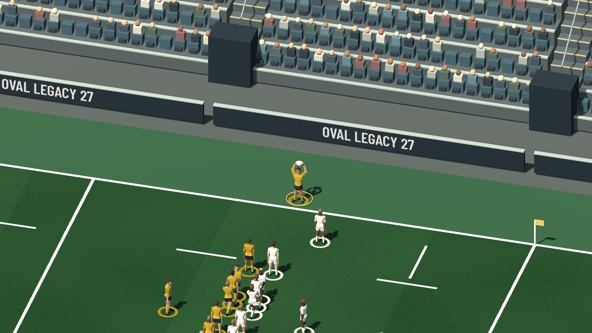
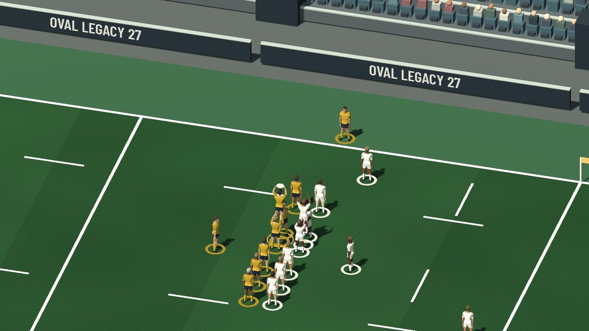
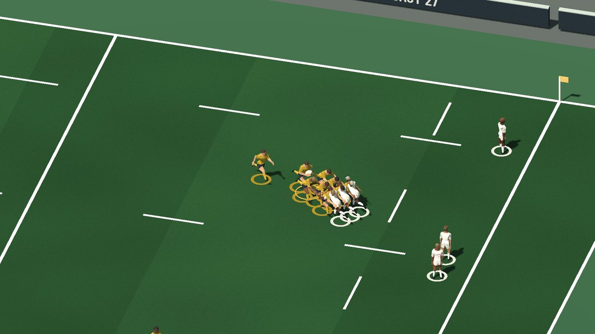
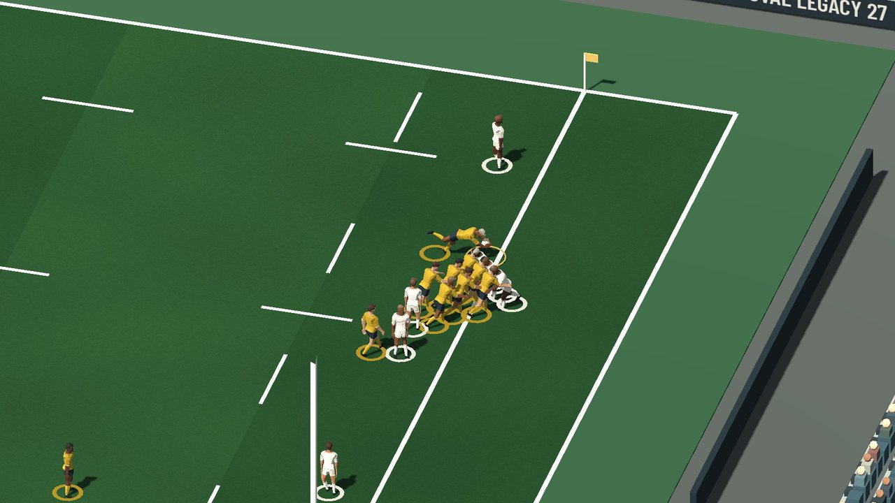
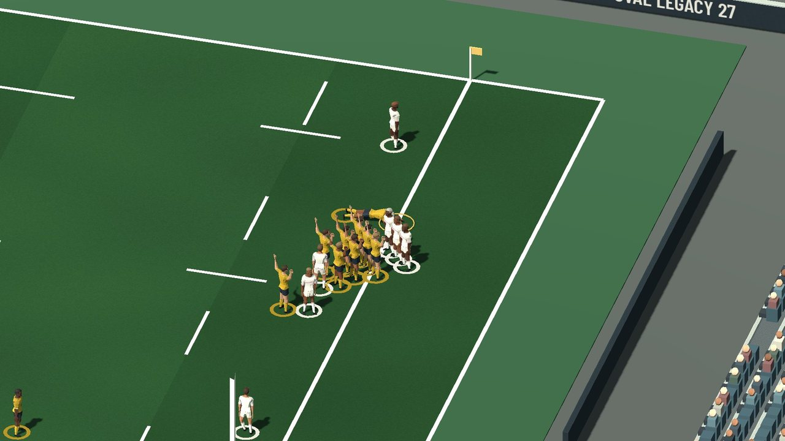
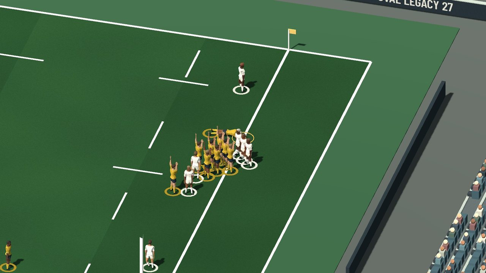
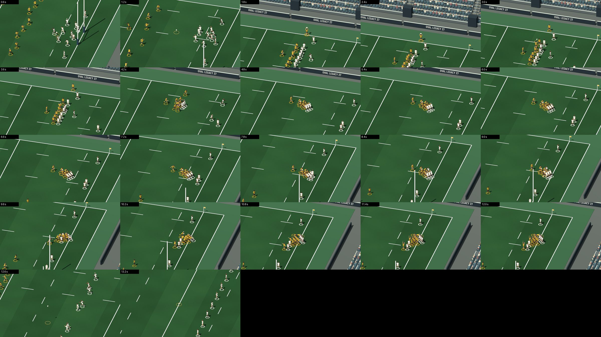
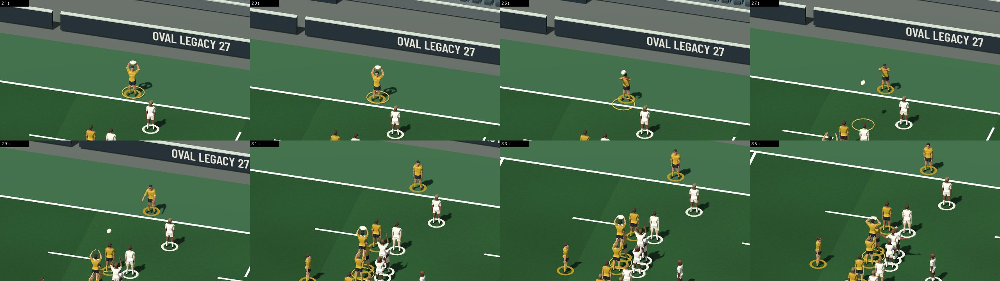
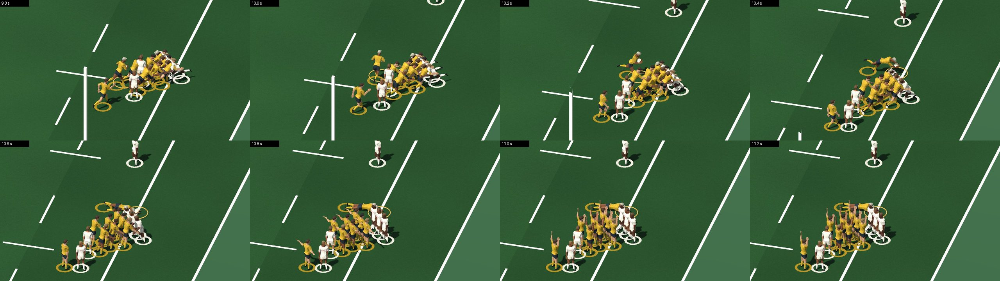

# Gestes de rugby dans le match 3D — 11 novembre 2026

Seconde moitié de la « tranche de démonstration » : une touche, un ballon porté,
un essai, reconnaissables sans légende. Branche `claude/tranche-demo-match-20261111`,
partie de `fe79c365` (tête de la PR 539).

## Ce qui est fait

Trois gestes, tous déclenchés par des faits que le moteur produit déjà. Rien
n'est décidé côté Godot : ni vainqueur, ni porteur, ni marqueur, ni point de ballon.

| Geste | Fait du moteur qui le déclenche | Ce que l'on voit |
| --- | --- | --- |
| Touche avec porteurs | scène `lineout` (alignement), puis `setpiece-win` ou `setpiece-loss` dont l'origine est une touche | Deux lignes séparées par un couloir entre les 5 et les 15 mètres, talonneur en touche ballon au-dessus de la tête, lancer vissé, deux blocs de saut portés, prise à deux mains par l'équipe que le moteur désigne, bloc adverse battu |
| Ballon porté | même fait `setpiece-win`, combinaison `maul` du carnet de jeu | Le sauteur redescend, le ballon passe à l'arrière, les avants se lient buste engagé, trois adversaires s'opposent, le regroupement avance jusqu'au point de ballon du moteur |
| Essai aplati | scène `try` | Le marqueur désigné par le moteur se détache, plonge bras tendus, ballon posé au point d'essai du moteur ; ses partenaires lèvent les bras. Hors ballon porté, le marqueur plonge seul et les trois partenaires les plus proches lèvent les bras |

Le match attend la fin d'un geste avant de demander l'action suivante, par le
mécanisme qui existait déjà pour la passe longue (`is_presenting_extended_pass`).

### Captures

Séquence rejouée : un vrai match simulé (club 2 du harnais de test, 76e minute) :
sortie en touche, alignement, « ECA conserve sa touche · Ballon porté », « Essai de
Lucas Faure sur ballon porté ».

Vue rapprochée (outil de contrôle, 8 m de hauteur visible — ce n'est pas un réglage du jeu) :

| | |
| --- | --- |
|  |  |
|  |  |
|  |  |

Caméra « action » du jeu, telle quelle (16 m de hauteur visible) :

| | |
| --- | --- |
|  |  |
|  |  |
|  |  |

Séquences d'images :

- caméra action, une image toutes les 0,6 s : 
- touche, vue rapprochée, toutes les 0,2 s : 
- essai, vue rapprochée, toutes les 0,2 s : 

Comparaison : [la même touche conservée sans les gestes](match-gestes-20261111/00-sans-gestes-touche-conservee.jpg)
et [la prise vue par la caméra TV par défaut](match-gestes-20261111/02-touche-prise-camera-tv.jpg).

### Lecture critique

- **Touche** : reconnaissable en vue rapprochée et en caméra action (lanceur bras
  levés, sauteur au-dessus des autres, ballon en l'air). Les bras des porteurs se
  devinent plus qu'ils ne se voient.
- **Ballon porté** : reconnaissable en vue rapprochée (porteur à l'arrière ballon
  contre lui, liés penchés, adversaires en face). En caméra action, on lit un bloc
  compact qui avance, moins nettement un maul. Les jambes sont celles de la marche
  du modèle : pas de vraie poussée jambes fléchies.
- **Essai** : plongeon et joueur allongé ballon au sol lisibles en vue rapprochée,
  petits mais lisibles en caméra action ; les bras levés aident beaucoup.
- **Caméra TV par défaut** (42 m de hauteur visible) : on voit les deux lignes de
  la touche et le regroupement, pas les postures. Les gestes ne se reconnaissent
  pas à cette distance.
- La mise en place de l'alignement est une course de 0,9 s depuis les positions
  précédentes : trop rapide pour être naturelle quand les joueurs viennent de loin.
- Les transitions entre poses sont des fondus calculés, pas des animations
  capturées : correct sur image fixe, encore raide en mouvement.

## Comment c'est fait

- `native/godot/match_gestes.gd` (nouveau) : toute la logique. Poses procédurales
  sur le squelette du modèle CC0 déjà livré (inclinaison du corps, flexion du
  buste, bras par le solveur à deux os existant de `match_presentation.gd`).
  **Aucune ressource ajoutée, aucun téléchargement.**
- `native/godot/match_view.gd` : une quarantaine de lignes de raccord, toutes sous
  `if _gestes`. Sans la variable d'environnement `CD_MATCH_GESTES=1` (ou l'appel
  `set_gestes(true)`), l'objet n'existe pas et le match est celui d'avant.
- Les gestes sont coupés en pause, en cadence accélérée et en mode calme
  (« mouvements réduits »).
- La combinaison « ballon porté » et l'équipe qui lance sont lues dans le journal
  transmis (`live.events`), pas devinées : l'adaptateur de scène n'est pas modifié.

### Ce qui relève de la présentation, pas du moteur

Le moteur ne désigne ni lanceur, ni sauteur, ni porteurs, et place les joueurs de
façon schématique. Sont donc distribués par poste, comme la passe en direct choisit
son passeur : talonneur (poste 2) au lancer, deuxième ligne (poste 5, à défaut 4) au
saut, piliers porteurs, les trois joueurs du bloc de saut adverse dans le maul. Les
joueurs mis en scène quittent leur position schématique le temps du geste puis la
rejoignent. Le ballon porté part de l'alignement et arrive au point de ballon du
moteur ; l'essai est aplati exactement à son point d'essai.

### Rugby

Référence relue : `docs/rugby-rules-reference.md` (lois 16, 18 et 21). Points tenus
dans la présentation : équipe qui lance fournie par le moteur (« ne pas inventer le
lanceur »), alignement entre les 5 et les 15 mètres, couloir entre les lignes,
talonneur adverse à deux mètres, maul avec porteur debout lié à au moins un
partenaire et un adversaire, maul jamais écroulé (le marqueur s'en détache), ballon
aplati sur la ligne de but. **Non vérifié** : le texte en ligne de World Rugby n'a
pas été relu pendant ce lot ; les distances fines (un mètre de couloir, dix mètres
des non-participants) ne sont pas mesurées par un test.

## Rejouer

```
# séquence du moteur (déjà dans le dépôt, vérifiée par le test)
node tests/godot-match-gestes-scenes.cjs > tests/fixtures/match-gestes-sequence.json
# test sans affichage : 104 contrôles
CD_GODOT_EXE=<godot> node --test tests/godot-match-gestes.cjs
# captures (affichage requis : Windows, X11 ou Xvfb)
CD_MATCH_GESTES_PROOF=<dossier> <godot> --path native/godot --script ../../tests/godot-match-gestes-capture.gd
```

Options de capture : `CD_MATCH_GESTES_SIZE`, `CD_MATCH_GESTES_CAMERA` (`action`,
`tv`, `tactical`), `CD_MATCH_GESTES_EVERY`, `CD_MATCH_GESTES_ZOOM`,
`CD_MATCH_GESTES_OFF=1`. Le script rejoue les scènes au rythme du direct (une
toutes les 0,32 s, suspendu pendant un geste) ; il ne change rien au déroulé du match.

## Mesures

| Mesure | Valeur |
| --- | --- |
| Durée de la séquence avec gestes | 13,4 s simulées : 1 s de jeu avant, 0,9 s d'alignement, 1,9 s de lancer, prise et redescente, 5,3 s de ballon porté, 3 s d'essai, 1,2 s après |
| Même séquence sans gestes | 3,2 s : sept scènes à 0,32 s |
| Rendu ici, 1920×1080, caméra action | 228 ms par image, soit environ 4 images par seconde |
| Rendu ici, 1280×720 | 173 à 185 ms par image |

Ces temps viennent d'une machine à deux processeurs sans carte graphique (rendu
logiciel llvmpipe, OpenGL de compatibilité). **Ils ne disent rien de la fluidité
sur un PC de jeu.** Les captures sont produites à pas fixe (1/30 s), donc
indépendantes de la vitesse de rendu.

La séquence fait 13 secondes, pas vingt : l'objectif « vingt secondes » n'est pas
atteint en durée, les trois gestes le sont.

## Ce qui n'est pas fait

- Passe, réception dans le jeu courant, plaquage, ruck, mêlée : inchangés.
- Touche perdue (`setpiece-loss`) et touche conservée sans ballon porté : couvertes
  par le code (l'autre bloc prend le ballon ; les joueurs sont relâchés après la
  prise) mais **sans capture ni contrôle dédié**.
- Essai hors ballon porté : contrôlé par le test, sans capture.
- Équipe qui attaque vers la gauche (côté 1) et seconde période : non capturées.
- Pas d'essai sur Windows, sur carte graphique réelle, ni dans une carrière
  lancée depuis l'interface (le script instancie la vraie vue de match et lui
  transmet les scènes du moteur, sans passer par l'écran de match).
- Bibliothèques d'animations externes : aucune essayée dans ce lot.

## Prochaine étape

Décider si les gestes deviennent le comportement par défaut ; si oui, rapprocher
la caméra pendant un geste (c'est elle qui limite la lisibilité) et remplacer les
poses calculées des jambes par de vraies animations de poussée et de plongeon.
