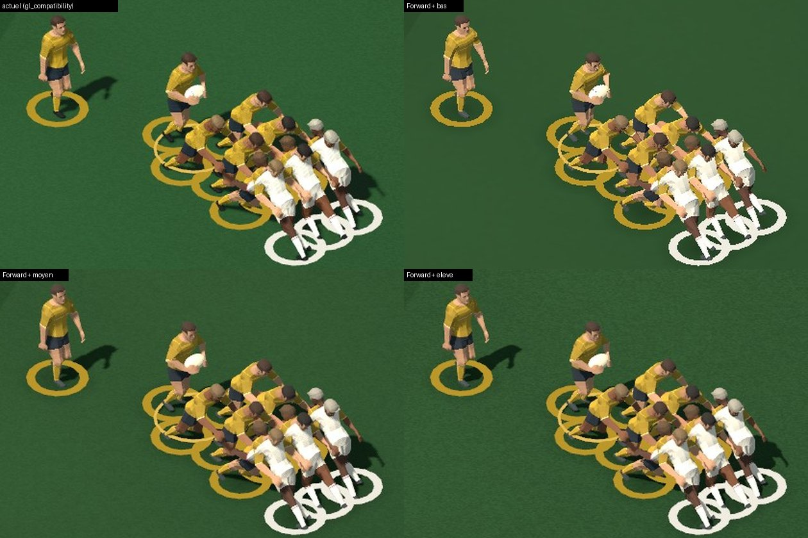
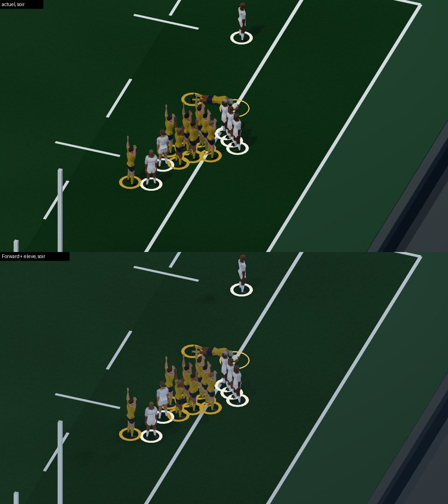

# Rendu moderne du match 3D (Forward+) — 11 novembre 2026

Branche `claude/match-rendu-moderne-20261111`, partie de `a244814e`
(`claude/tranche-demo-match-20261111`, PR #554, gestes derrière `CD_MATCH_GESTES=1`) :
**elle contient #554.**

But : une séquence de match nettement plus propre sur le PC de Léo (RTX 4080 SUPER,
1,5 ms par image aujourd'hui), sans changer de moteur ni le rendu par défaut, sans
décision de direction artistique, et sans rien casser sur les machines modestes.

## En bref

- **Rendu par défaut inchangé** : `project.godot` reste en `gl_compatibility`. Sous ce
  rendu, rien n'est installé : les 82 + 82 images de la séquence témoin (caméras TV et
  action) sont **identiques à l'octet près** avant et après, et les mesures des tests
  du match sont identiques (voir « Tests »).
- **Forward+ se choisit au lancement** (`--rendering-method forward_plus`). La scène du
  match lit la méthode réellement active (`RenderingServer.get_current_rendering_method()`)
  et n'installe le rendu moderne (`native/godot/match_rendu.gd`) que sous Forward+.
- Trois niveaux, branchés sur le réglage de qualité **existant** du match
  (Économie / Équilibré / Détail = bas / moyen / élevé).
- **Rien n'a été vu sur une vraie carte graphique.** Ici : rendu logiciel (lavapipe),
  2 cœurs. Images, coût et premier lancement sont à vérifier avec l'outil de capture.

## Comment lancer

Depuis les sources (Windows, PowerShell, racine du dépôt) :

```powershell
& "C:\chemin\Godot_v4.7.2-stable_win64.exe" --path native/godot --rendering-method forward_plus --rendering-driver vulkan
# ou --rendering-driver d3d12
```

Un exécutable exporté accepte les mêmes options après son nom
(`"Rugby Legacy 27.exe" --rendering-method forward_plus --rendering-driver vulkan`) :
**non vérifié** sur l'export Windows.

- `CD_MATCH_RENDU=actuel` : coupe le rendu moderne même sous Forward+ (comparaison, ou
  repli si un effet pose problème sur une machine).
- `CD_MATCH_RENDU_TONEMAP=filmique` : courbe filmique au lieu de la courbe linéaire
  (option, voir « Courbe de tons »).
- Pourquoi pas `CD_MATCH_RENDU=moderne` pour **choisir** Forward+ : Godot fixe la
  méthode de rendu au démarrage. Une variable ne pourrait la changer qu'en relançant le
  processus ou en écrivant un `override.cfg` : ni l'un ni l'autre n'est propre. La
  variable sert donc seulement à couper (`actuel`) ; la ligne de commande choisit.
- Sans Vulkan ni D3D12, Godot 4.7 se replie sur OpenGL : le match retrouve alors
  exactement l'image actuelle (rendu moderne non installé).

## Ce qui est activé, par niveau

| | Bas (Économie) | Moyen (Équilibré) | Élevé (Détail) |
| --- | --- | --- | --- |
| Anticrénelage | MSAA 2x du jeu, inchangé | MSAA 4x | MSAA 8x |
| Ombres du soleil | coupées (comme aujourd'hui en Économie) | atlas 4096, filtre doux bas, cascades réglées | atlas 8192, filtre doux haut, pénombre 0,5°, fondu entre cascades |
| Occlusion ambiante (SSAO) | non | moyenne, demi-résolution | haute, pleine résolution |
| Ombres des projecteurs (soir) | non | non | oui (4 projecteurs, atlas 4096) |
| Ombres de contact sous les joueurs | oui | oui | oui |
| Relief de la pelouse | 0,6 | 1 | 1 |
| Ambiance tirée du ciel, étalonnage | oui | oui | oui |

Commun aux trois niveaux :

- **Cascades d'ombre à l'échelle du terrain.** Les caméras du match sont
  orthographiques ; Godot ignore alors la distance maximale d'ombre et étale les
  cascades du plan proche au plan lointain (500 m) : presque toute la résolution
  tombait hors du terrain. Le plan lointain passe à 320 m (contenu le plus lointain
  ≈ 175 m) et chaque cascade finit à une distance choisie par caméra : TV 75 / 100 /
  130 m (terrain visible entre ≈ 64 et 122 m), action 26 / 36 / 60 m, tactique 132 /
  146 / 162 m. Ordre de grandeur déduit : 4 à 5 cm par texel sur le terrain en TV au
  niveau moyen, 2 à 2,5 cm en élevé.
- **Ambiance tirée du ciel existant** (mêmes couleurs, contribution 0,55) : dessus des
  volumes plus clairs que les dessous. Le soleil est exclu du ciel ambiant (il éclaire
  déjà directement). Le soir garde l'ambiance de couleur du kit (pas de ciel de jour la
  nuit).
- **Ombres de contact** : un décalque radial doux (texture générée, aucun asset) sous
  chaque joueur, projeté sur le seul sol (calque 20) : marqueurs d'équipe, maillots et
  ballon ne sont jamais assombris. Utile surtout au niveau bas, sans ombres du soleil.
- **Pelouse** (`shaders/stadium_surface_moderne.gdshader`) : bloc de couleur copie
  conforme de la pelouse d'origine (vérifié par test), plus des normales procédurales
  (brins couchés dans un sens puis l'autre selon les bandes de tonte existantes,
  ondulation de plusieurs mètres, grain qui s'efface avec la distance comme le grain de
  couleur) et un reflet très faible. Pas de nouvelle bande ni de nouvelle couleur.
- Écartés exprès : **halo (glow)**, **brouillard**, **profondeur de champ**, **SSIL**,
  **SDFGI**. Avec des caméras orthographiques (toute la scène à ≈ 93 m de la caméra
  TV), un brouillard de distance n'ajoute qu'un voile uniforme et une profondeur de
  champ flouterait les joueurs : les deux desservent la lisibilité. SSIL teinterait
  les maillots du vert de la pelouse ; le halo est un choix de style.
- **TAA écarté** au profit du MSAA : sur des joueurs de 30 à 50 pixels qui bougent, le
  TAA traîne et floute ; le MSAA lisse les contours sans retard.

## Étalonnage : pourquoi Forward+ « délave » l'image (constat mesuré)

À réglages égaux, Forward+ donne une image nettement plus claire et plus grise que
le jeu actuel (luminance moyenne 0,48 contre 0,33 sur la séquence, saturation 0,27
contre 0,46). C'est le « jour délavé » qu'avait aussi vu la PR #545. Cause mesurée
ici : `gl_compatibility` éclaire dans l'espace sRGB, Forward+ en espace linéaire.

- Les **valeurs brutes** des shaders et des couleurs d'instance, réglées à l'œil sous
  `gl_compatibility`, sont lues comme linéaires par Forward+ : la pelouse et le public
  y blanchissent. Correction d'espace colorimétrique (Forward+ seulement) : la couleur
  de la pelouse est convertie sRGB → linéaire dans le shader moderne, les couleurs du
  public sont déclarées sRGB (`vertex_color_is_srgb`). Mêmes teintes, pas de nouvelles.
- L'éclairage direct, l'ambiance et les ombres n'ont pas le même poids dans les deux
  espaces. Étalonnage mesuré (séquence témoin, caméra TV, régions pelouse, bord du
  terrain et maillots blancs, au soleil et à l'ombre) : soleil × 1,96, ambiance 0,6
  le jour ; ambiance 0,6 et projecteurs × 1,6 le soir. Écart moyen restant ≈ 0,01
  (jour) et 0,02 (soir) sur une échelle de 0 à 1.
- **Écart résiduel assumé** : saturation un peu plus basse en Forward+ (jour 0,41
  contre 0,46 ; soir 0,52 contre 0,65, surtout dans les verts sombres). C'est une
  propriété de l'éclairage linéaire. Le compenser demanderait un étalonnage couleur
  global (saturation, contraste), qui est un choix de direction artistique : laissé à
  la graphiste, comme l'avait fait #545 à sa manière.

### Courbe de tons

Par défaut la courbe reste **linéaire**, comme aujourd'hui : les couleurs non
éclairées (marqueurs d'équipe, halo du ballon, blason du club) restent exactement
celles de la palette. La courbe **filmique** adoucit les hautes lumières (lignes,
maillots blancs, projecteurs) mais fait passer toutes les couleurs par la courbe,
marqueurs compris : à 1,5 d'exposition, les marqueurs jaunes ressortent plus vifs.
C'est donc une option (`CD_MATCH_RENDU_TONEMAP=filmique`, étalonnée elle aussi :
exposition 1,5 / blanc 2 le jour, 1,12 le soir), capturée par l'outil pour que la
graphiste tranche.

## Ce qu'apporte la PR #545 et ce qui est repris

#545 (`claude/match-rendu-cinema-20261110`, brouillon) passe **le projet entier** en
Forward+ (repli OpenGL), remplace les caméras TV et action par des caméras en
perspective (TV « sur rail »), et règle AgX, contraste 1,14, saturation 1,28,
brouillard, halo, SSAO, SSIL, brouillard volumétrique et ombres des projecteurs en
« Détail », plus un outil de 18 vues (`tests/godot-match-render-capture.gd`).

- **Repris** : la détection par `get_current_rendering_method() == "forward_plus"`, le
  principe des effets par niveau, l'idée des ombres des projecteurs en Détail, des
  ordres de grandeur SSAO.
- **Non repris** : le changement du rendu par défaut (exclu par la demande) ; les
  caméras en perspective (cadrage = autre chantier, et les gestes de #554 règlent leur
  cadrage sur les caméras orthographiques actuelles) ; contraste, saturation, AgX,
  couleurs des projecteurs (choix de style) ; brouillard, halo, SSIL (voir plus haut).
- Les deux branches modifient `match_view.gd` et `match_stadium_evening.gd` (ici :
  `match_view.gd` seulement, 19 lignes d'accroche). À arbitrer si les deux avancent.

## Coût attendu (déduit, non mesuré sur GPU)

- Bas : proche de l'actuel (pas d'ombres du soleil ni d'occlusion ; 30 petits
  décalques, une pelouse un peu plus calculée).
- Moyen : ombres 4 cascades sur atlas 4096, SSAO demi-résolution, MSAA 4x. Quelques
  dixièmes de milliseconde à 1440p sur une RTX 4080 (déduction).
- Élevé : atlas 8192, SSAO pleine résolution, MSAA 8x, 4 projecteurs ombrés le soir.
  Probablement 1 à 3 ms à 1440p sur une RTX 4080 (déduction) ; c'est le niveau à
  surveiller sur une machine modeste.
- Premier lancement Forward+ : compilation des shaders (cache ensuite). Non mesuré.
- Ici, en rendu logiciel (sans valeur pour un GPU) : 640×360, caméra TV, temps GPU
  médian 232 ms en `gl_compatibility` et 79 ms en Forward+ bas.

## Outil de capture pour le PC

`tests/godot-match-rendu-capture.cjs` pilote `tests/godot-match-rendu-capture.gd` :
même séquence du moteur que `godot-match-gestes-capture.gd` (touche, ballon porté,
essai, gestes activés), rendue dans un SubViewport de taille exacte avec le MSAA 2x du
jeu. Passes : `actuel` (gl_compatibility, Équilibré), `bas`, `moyen`, `eleve`,
`moyen-filmique` ; pour chaque ambiance (jour, soir), caméra (TV, action) et taille
(1280×720, 2560×1440). JPEG numérotés et `report.json` par passe (méthode de rendu
active, pilote, carte, réglages, temps GPU/CPU par image, mesure sans capture,
mémoire vidéo), `index.json` global.

Préparation, une fois (écrit dans `native/godot`, comme pour tout test Godot) :

```powershell
python scripts/build-godot-prototype.py --stage-only --node "C:\Program Files\nodejs\node.exe"
& "C:\chemin\Godot_v4.7.2-stable_win64_console.exe" --headless --path native/godot --import
```

Capture :

```powershell
$env:CD_GODOT_EXE = "C:\chemin\Godot_v4.7.2-stable_win64_console.exe"
$env:CD_MATCH_RENDU_CAPTURES = "C:\chemin\captures-rendu"
node tests/godot-match-rendu-capture.cjs
```

- Tout est écrit dans `CD_MATCH_RENDU_CAPTURES\<date-heure>\` ; le dossier
  utilisateur de Godot (journal, caches de shaders) y est redirigé (`APPDATA`,
  `LOCALAPPDATA`, `TEMP`). Le pilote NVIDIA peut garder son propre cache ailleurs.
- L'outil s'arrête en erreur si Forward+ ne s'est pas activé (méthode réellement
  active relue par Godot), et le dit. `CD_MATCH_RENDU_PILOTE=d3d12` pour essayer D3D12.
- Variables de réduction : `CD_MATCH_RENDU_PASSES`, `CD_MATCH_RENDU_TAILLES`,
  `CD_MATCH_RENDU_CAMERAS`, `CD_MATCH_RENDU_AMBIANCES`, `CD_MATCH_RENDU_EVERY`.
- Volume attendu avec les valeurs par défaut : 40 passes, environ 6 700 images,
  de l'ordre de 1,5 Go et 15 à 30 minutes (estimation).
- Exécuté ici de bout en bout (Linux, Xvfb, rendu logiciel, 640×360, TV, jour,
  passes `actuel` et `bas`) : 8 + 8 images, méthode relue `gl_compatibility` puis
  `forward_plus`/`vulkan`, rien d'écrit hors du dossier de sortie (vérifié). **Jamais
  lancé sous Windows.**

## Aperçus en rendu logiciel (indicatifs)

Rendu Vulkan logiciel (lavapipe), 1280×720 recadré : ce n'est pas l'image d'une
RTX 4080 (même calcul, mais aucune mesure de performance ni de rendu pilote).

- Niveaux, jour, caméra TV : 
- Soir, caméra TV, actuel puis élevé : 

Lecture honnête : à 720p, l'écart avec l'actuel est **modeste** — contours plus nets
(MSAA), ombres plus fines et plus douces en élevé, ombres croisées des projecteurs le
soir, volumes un peu plus modelés. Les mêmes joueurs low-poly, la même pelouse et le
même public limitent le gain : ce rendu ne rendra pas le match « nettement plus beau »
à lui seul. Le gain le plus net attendu est en 1440p (MSAA 8x, ombres 8192).

## Ce qui n'a pas été vu à l'écran

- Rien sur une vraie carte graphique : aspect réel, ombres douces filtrées par le
  pilote, coût, premier lancement, D3D12, export Windows.
- SSAO avec caméra orthographique : actif ici, effet faible à l'œil en 720p logiciel.
- Caméra action et vue tactique en Forward+ : couvertes par les tests (réglages,
  cascades), pas regardées image par image.
- Écran de match complet (interface autour du SubViewport) : non lancé en Forward+.

## Tests

Exécutés ici (Linux, Godot 4.7.2, `xvfb-run`), avant (`a244814e`) et après :

| Suite | Avant | Après | Mesures |
| --- | --- | --- | --- |
| godot-match-gestes | réussite | réussite | identiques (129 contrôles) |
| godot-match-framing | réussite | réussite | identiques |
| godot-match-pass | réussite | réussite | identiques |
| godot-match-contact07 | réussite | réussite | identiques |
| godot-match-cut (+ intégration) | réussite | réussite | identiques |
| godot-match-motion | réussite | réussite | identiques |
| godot-match-presentation | réussite | réussite | identiques |
| godot-match-stadium-evening | réussite | réussite | identiques |
| godot-match-silhouettes | réussite | réussite | identiques (hors `build_us`, durée) |
| **godot-match-rendu** (nouveau) | — | réussite | 392 contrôles |

- Séquence témoin `godot-match-gestes-capture.gd` (rendu par défaut, Xvfb) : TV et
  action, 82 images chacune, **identiques à l'octet** avant/après.
- `godot-match-rendu` : sous `gl_compatibility` (méthode réelle en `--headless`), aucun
  réglage modifié à aucun niveau, jour et soir, même avec `CD_MATCH_RENDU=moderne` ;
  Forward+ simulé : réglages de chaque niveau, réversibles sur trois passages, cascades
  par caméra, soir, option filmique, `CD_MATCH_RENDU=actuel` ; bloc de couleur de la
  pelouse moderne identique à l'original ; `project.godot` toujours en
  `gl_compatibility`.

## Pistes suivantes (autres chantiers)

- Modèles et matières des joueurs (le principal plafond de l'image).
- Public : silhouettes, animation légère, éclairage propre.
- Animations en capture de mouvement.
- Direction artistique : courbe filmique ou non, étalonnage couleur Forward+, halo
  des projecteurs, choix entre caméras orthographiques et perspective (#545).
- Si le rendu moderne convainc sur PC : exposer « Forward+ » comme réglage du jeu
  (relance nécessaire) plutôt qu'une option de ligne de commande.
