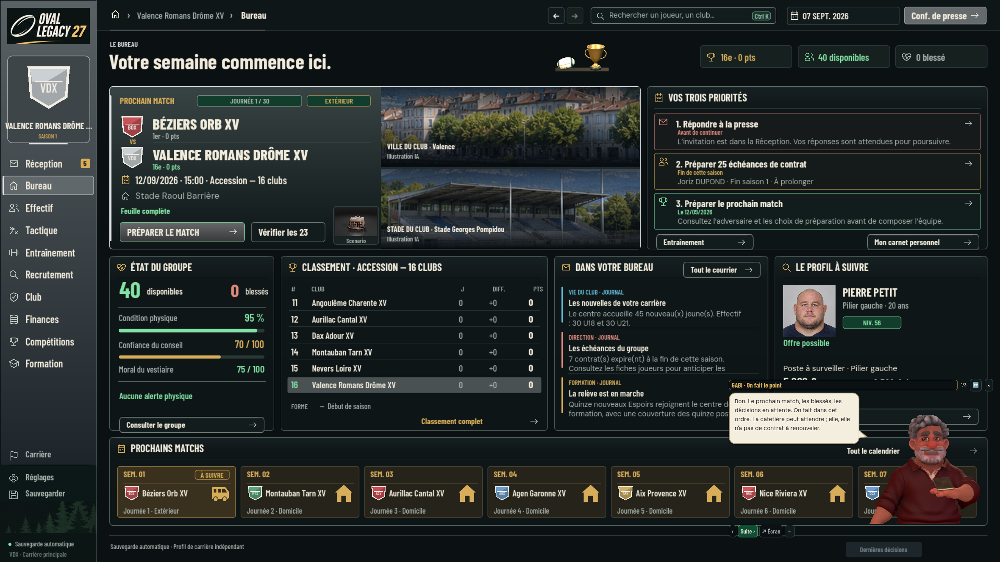
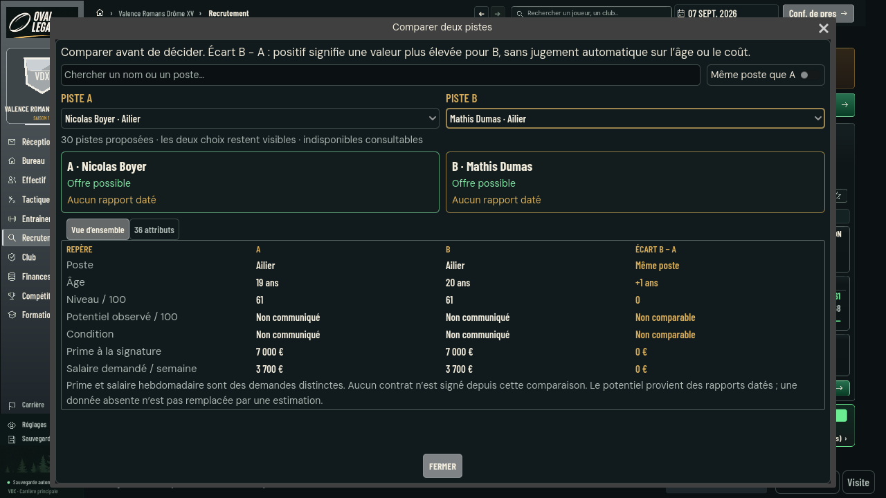
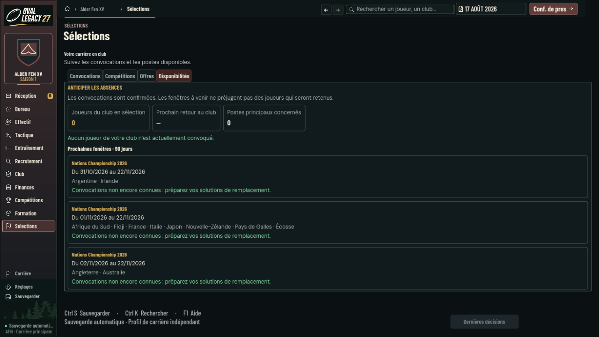
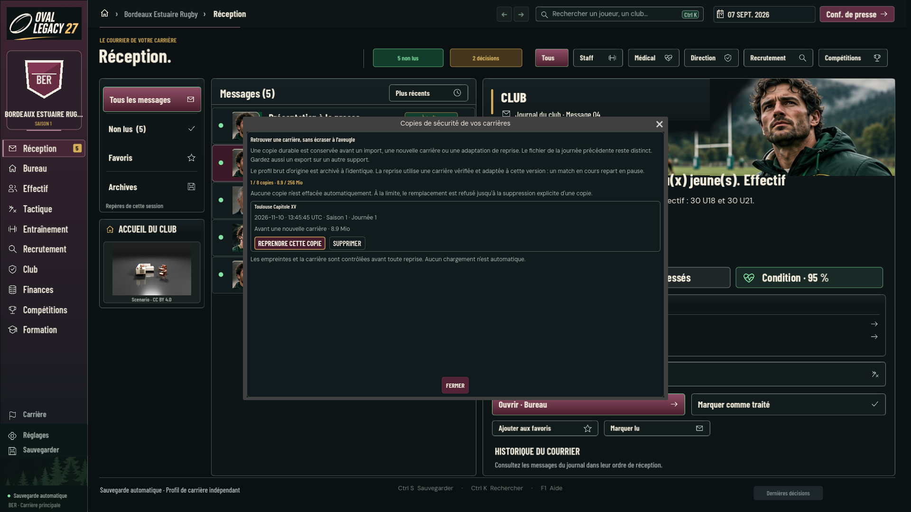
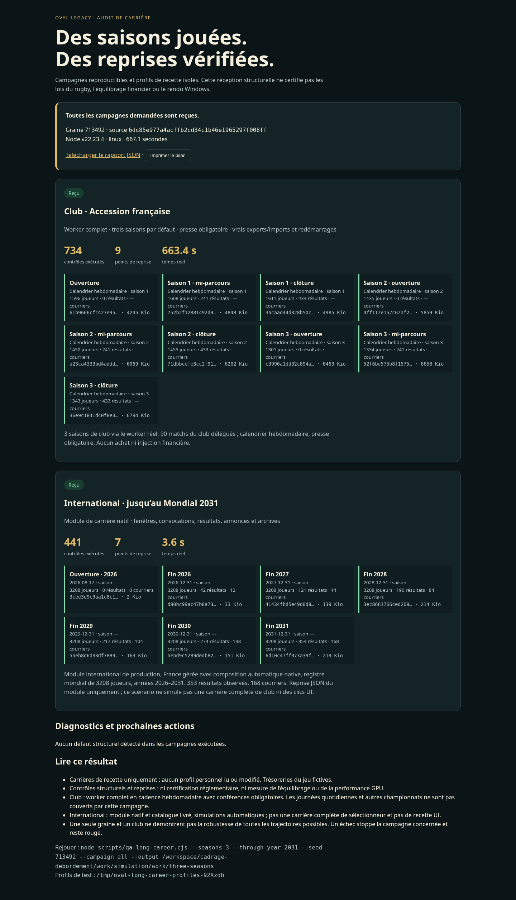

# Oval Legacy — six chantiers Cloud reçus

Reprise du 10 novembre 2026, demandée par Léo. Livraison cumulative dans la [PR #510](https://github.com/Xynph/cadrage-debordement/pull/510), sur la base #508 `cd3fa73c9a2aeb9e260e67fceed82097820b9573`. `main` vérifié avant reprise : `978803ba727e51c5af23f458868c6d56cc878966`. Aucun push sur main, aucune fusion ni réécriture des branches PC.

## Essayer les six parcours

| Parcours | Où aller | Ce qui est maintenant disponible |
| --- | --- | --- |
| Bureau | Bureau, en format compact ou large | Trois priorités expliquées avec échéance et action. Presse, direct/résultat, match du jour, feuille, trésorerie, absences et contrats utilisent la même sélection. Le bilan reste accessible en intersaison et l'entraînement est fermé en clôture. |
| Comparer deux joueurs | Recrutement → Comparer deux pistes | Deux sélections persistantes, recherche multi-mots, même poste, synthèse puis 36 attributs groupés. Les écarts B−A sont expliqués, le salaire hebdomadaire est séparé de la prime, une donnée absente reste « Non communiqué ». Les indisponibles restent consultables. |
| Anticiper les convocations | Calendrier → Anticiper les absences, ou Sélections → Disponibilités | Absents confirmés, retours, postes principaux et profondeur disponible. Les fenêtres des 90 prochains jours sont séparées des joueurs réellement convoqués. Les liens ouvrent la bonne fiche et la composition. |
| Préserver une carrière | Échap ou logo du jeu → Copies de sécurité | Copie durable avant remplacement/import/adaptation, liste et quota visibles, restauration ou suppression confirmées. Huit copies et 256 Mio maximum, aucun effacement automatique. En cas de refus d'écriture ou de validation, la carrière actuelle est conservée. |
| Aide et clavier | F1 ; Ctrl+K puis Échap | Gabi silencieux, animations et mouvements réduits conservés ; guide dégagé des actions de recrutement, focus conservé après remise à zéro et fermeture de la recherche. |
| Contrôler plusieurs saisons | Commande ci-dessous, puis ouvrir index.html | Rapport HTML/JSON, chronologie, points de reprise, diagnostics et limites. Le pilote utilise uniquement ses propres profils temporaires, sans injecter des scores ou de la trésorerie. |

```sh
node scripts/qa-long-career.cjs --seasons 3 --through-year 2031 --seed 713492 --output work/qa-long-career
```

Le pilote peut recevoir un autre checkout en lecture seule via `OVAL_QA_SOURCE_ROOT`. Le rapport consigne séparément le commit et les empreintes du moteur et du pilote. Les suppressions nécessaires au quota concernent uniquement les copies de ses profils QA identifiés ; elles passent par la commande confirmée et sont tracées.

## Galerie de la réception

Les captures sont issues de Godot sous Linux, sans retouche. Les profils sont jetables. Les scénarios UI contrôlés testent l'affichage et les interactions ; ils ne sont pas présentés comme des saisons réellement jouées.

### Bureau et guide — vraie carrière, 1440p



[Format 720p](oval-six-chantiers-cloud-20261110/bureau-720.png) · [Clôture de saison, projection UI contrôlée](oval-six-chantiers-cloud-20261110/bureau-cloture-1080.png)

### Comparer deux vrais candidats — 720p



[Attributs groupés en 1440p](oval-six-chantiers-cloud-20261110/attributs-1440.png). Le comparateur ne signe aucun contrat.

### Disponibilités internationales — 720p



[Cas contrôlé avec convocations et retours](oval-six-chantiers-cloud-20261110/international-controle-720.png). Les tests moteur reçoivent séparément les dates, suspensions, retours bissextiles et l'absence de mutation.

### Copies de sécurité — vraie création et restauration



Le banc ouvre le vrai menu au clavier, annule sans écrire, restaure la carrière choisie vers sa Réception, puis supprime uniquement une copie confirmée.

### Rapport de simulation



[Rapport HTML à télécharger et ouvrir](qa-long-career-20261110/index.html) · [JSON](qa-long-career-20261110/report.json) · [Vue mobile 390 px](qa-long-career-20261110/apercu-390.png) · [Campagne distincte sur le moteur cumulatif](qa-long-career-20261110/cumul-4a278be/report.json).

## Résultats et sources exactes

| Réception | Résultat observé |
| --- | --- |
| Guide, clavier, voix, gestes et GLB réel sur cumul exact `76907de` | 5 suites vertes : 501 + 133 + 199 + 32 + 33 contrôles ; aucun ignoré. [Rapport](oval-six-chantiers-cloud-20261110/guide-cumul.json). |
| Bureau corrigé | 92 contrôles sans fenêtre ; 98 avec rendu et six captures en 720/1080/1440p. Profil inchangé. |
| Comparateur | 45 contrôles sans fenêtre ; 51 avec rendu et six captures aux trois tailles. Profil inchangé. |
| International | 57 tests Node ; 13 contrôles UI sans fenêtre ; 17 avec rendu à chacune des trois tailles. |
| Protection des carrières | 8 tests de fichiers ; 7 scénarios worker (restauration A→B→A→B, RNG/horloge, migration, refus de publication) ; 19 contrôles graphiques intégrant les vrais menus. |
| Régressions de stockage | Présentation persistée et atomicité commune/mondiale reçues par le producteur, puis lot Node cumulatif de 64 tests vert : 57 internationaux + 7 worker de sécurité. |
| Ancien banc recrutement/presse | 39 contrôles reçus après exposition du vrai module d'attributs et préparation de l'invitation réelle. Aucune assertion métier supprimée. |
| Pilote de simulation | 4 tests courts ; test natif de neuf imports distincts, suppression confirmée au neuvième et huit copies conservées, vert. |
| Campagne longue de référence | 3 saisons club, 90 matchs délégués, 734 contrôles et 9 reprises ; international 2026–2031, 441 contrôles, 7 checkpoints, 353 résultats. Total 1 175 contrôles. Source `6dc85e9`, avant les nouvelles protections. |
| Campagne distincte avec protections, cumul propre `4a278be` | Une saison, 242 contrôles, 3 reprises ; même état sportif et RNG. Le test du quota utilise encore un autre profil QA. |
| Rapport HTML | 6 contrôles Chromium, téléchargement JSON et absence de débordement en 1440/390 px. |

Environnement : Linux, Node 22.23.4, Godot 4.7.2, X11/Mesa llvmpipe pour les images. Les nombres de contrôles se recoupent entre certains bancs ; ils ne sont pas additionnés en une garantie de couverture totale. La CI distante et son SHA exact sont consignés dans la description de la PR #510 après réception terminale.

Les [rapports et journaux](oval-six-chantiers-cloud-20261110/) sont conservés avec leurs [empreintes](oval-six-chantiers-cloud-20261110/sha256.json). La première tentative de recette graphique exhaustive du guide a atteint son ancien délai de 150 secondes et rencontré l'absence d'ALSA. Le lanceur Linux a ensuite été corrigé pour utiliser Dummy et un délai borné ; la validation graphique présente repose sur les recettes ciblées des écrans et du modèle réel, pas sur une exécution complète de cet ancien banc graphique.

## Limites et suite PC

Les sources Blender manches/carnet citées dans #507 sont sur le PC et ne sont pas accessibles ici. Le GLB de la passation reste inchangé. Il faut assembler les retouches sur PC, réexporter le modèle, recevoir le rendu Windows et reconstruire le ZIP depuis le commit retenu. L'import Rugby Réel Windows reste également à recevoir. Aucune nouvelle validation Windows, cadence GPU ou livraison de ZIP n'est revendiquée.

Les PR #509 à #515 restent des branches de production indépendantes ; #510 contient leur intégration. Elles ne doivent pas être fusionnées séparément à l'aveugle dans main. L'intégrateur conserve les protections et le gate officiel. Les chantiers suivants ne sont pas démarrés dans ce lot.

GPT‑6.1 Sol : effort élevé pour la réception PC et le prochain lot fonctionnel ; effort moyen pour rejouer ces recettes ciblées.
