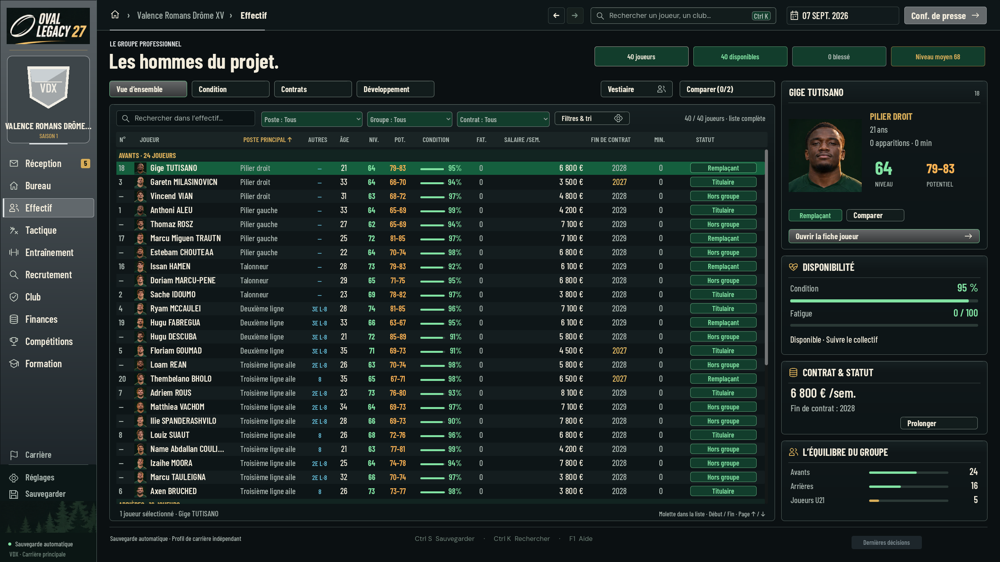
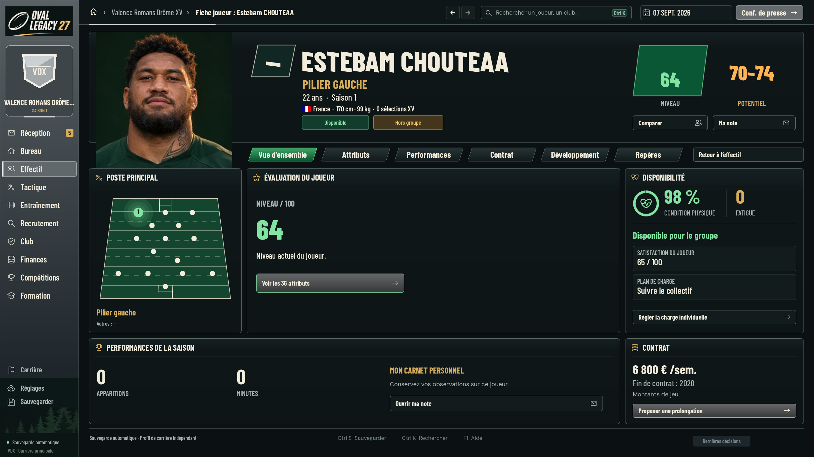

# Progression pendant la saison et potentiel évolutif

Le niveau actuel progresse pendant la saison : entraînements et minutes jouées alimentent le budget d’apprentissage existant. Les joueurs détaillés gagnent leurs vrais attributs, sans attendre l’intersaison. Le professionnalisme module modestement cet apprentissage. Les spécialisations et le mentorat orientent le même budget ; ils n’ajoutent pas une récompense indépendante. Le vieillissement annuel conserve ses effets d’âge, sans payer une deuxième fois les progrès déjà acquis.

La fiche reprend les vrais postes principaux et secondaires du joueur, comme l’Effectif. Son terrain distingue le groupe principal en vert et les autres postes maîtrisés en or, sans confondre un placement autorisé avec une compétence. La note au poste est réservée à la Tactique, y compris dans la fiche compacte.

Le potentiel est un plafond possible, jamais une promesse. Une révision annuelle s’appuie sur le travail, la progression, les performances ajustées à l’opposition et la personnalité. Une bonne saison peut apporter+1, exceptionnellement+2 pour un très jeune joueur ; la plupart des bilans peuvent rester stables. Une stagnation prolongée dans de mauvaises conditions de travail peut réduire les perspectives. Blessure ou absence de temps de jeu seules ne constituent pas une sanction du potentiel. Les bornes initiales d’équilibrage sont−4/+8 nets depuis l’activation, sans descendre sous le niveau atteint ni dépasser99.

Les rencontres du club humain, de l’IA et des Espoirs utilisent les participants réels. Aucun bonus automatique de potentiel à640 minutes. Les centres IA et invités conservent leur compensation annuelle existante de niveau actuel ; aucun XP hebdomadaire supplémentaire n’est inventé pour eux.

Nos joueurs gardent un niveau exact et un potentiel en fourchette de cinq valeurs. Les adversaires restent inconnus avant observation et leur niveau reste une fourchette après observation. Le potentiel exact n’est jamais publié. Le bilan propre est qualitatif : en hausse, stable ou revu à la baisse. Les anciennes observations adverses ne se mettent pas à jour gratuitement.

Les anciennes carrières commencent leur suivi au premier événement nouveau, sans réécrire l’historique ni relancer la variation de départ. Import et redémarrage conservent les progrès. Consultation et export ne changent pas la carrière ni le RNG.

## Réception

- 16 tests sur l’apprentissage en saison, les personnalisations, l’absence de double gain, les bilans annuels, une saison complète, les cartons, l’IA et les centres invités.
- 38 tests de mentorat et de suivi des jeunes ; quatre tests de génération et de migration des potentiels, avec vérification des fourchettes publiques.
- Vrai worker : attributs et niveau gagnés par la commande d’entraînement, spécialisation proposée dans le modèle UI, répétition hebdomadaire refusée, export/import/reprise conservés et import altéré refusé atomiquement.
- Parité du worker et du moteur natif direct : état, match délégué, RNG, reprise et refus d’écriture.
- 216 contrôles graphiques réels et37 helpers UI, captures du jeu en2560×1440, avec les rôles secondaires abrégés et les potentiels en fourchette. Les portraits sont ceux du jeu. Les exports privés de carrière ne sont pas publiés.

Livraison empilée dans la PR538 sur536 ; aucun de ces lots de jeu n’est présenté comme intégré à main. La règle de collaboration critique a été intégrée séparément par la PR537.
