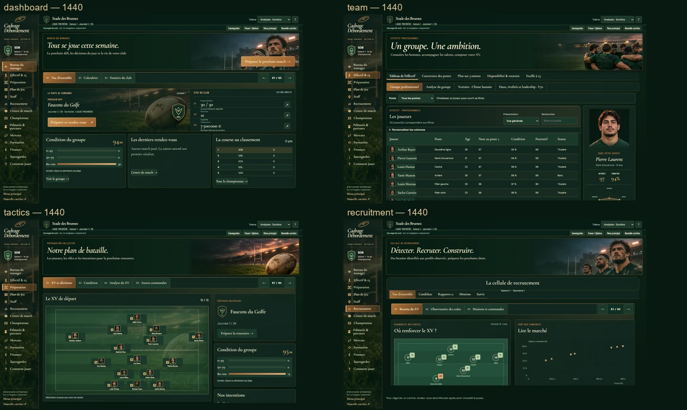
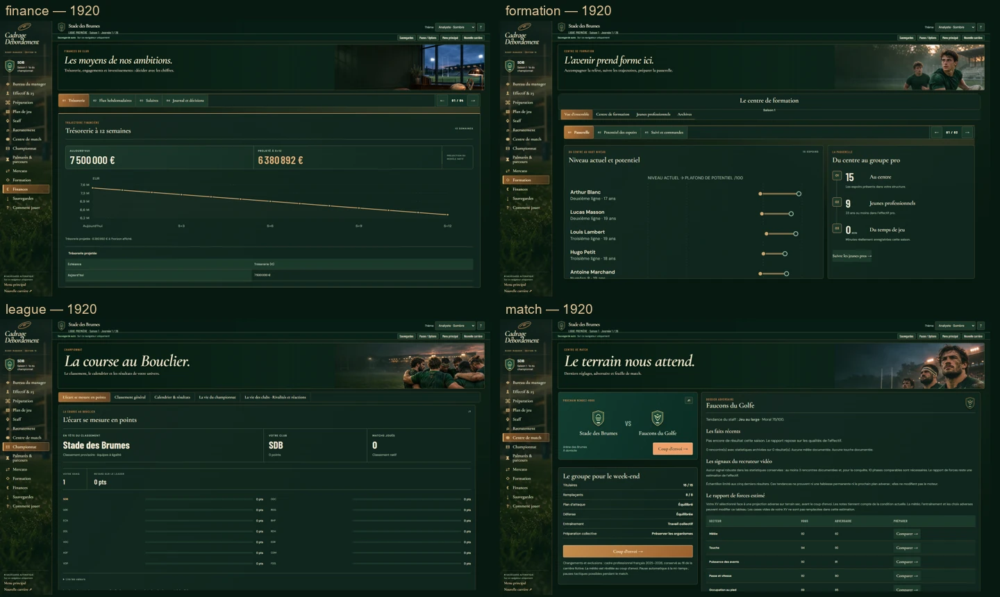
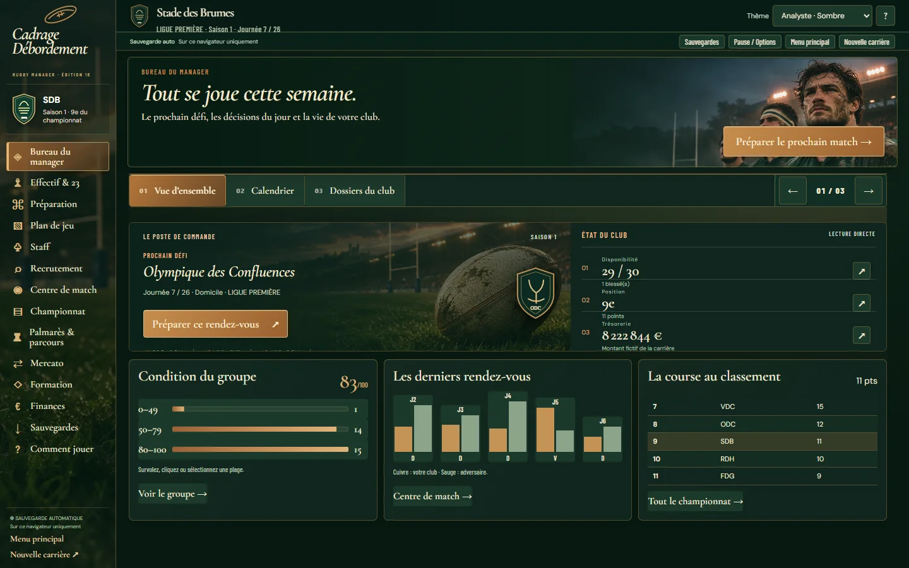
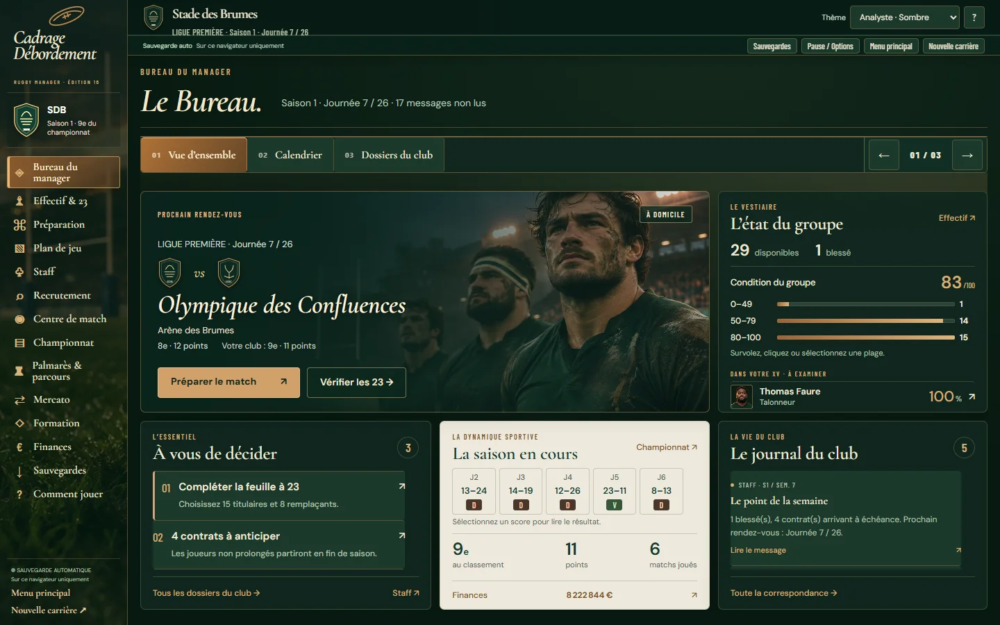
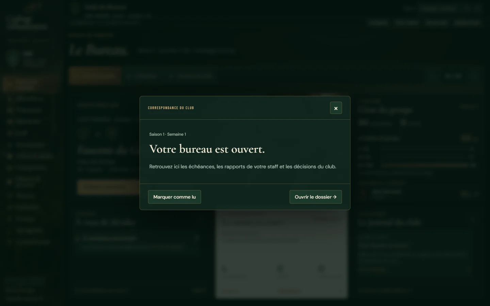

# Audit visuel natif et Bureau Premium PC — 7 novembre 2026

## Résultat et périmètre

Le Bureau est recomposé dans le vrai jeu (`dist/premium-editorial.js/.css`). Une seule scène dominante présente le prochain match ; groupe, décisions et journal sont visibles ensemble. Les titres utilisent Cormorant local ; les textes et chiffres du Bureau utilisent DM Sans. Les images originales, atlas de portraits fictifs et blasons déjà embarqués sont réutilisés.

Baseline GitHub vérifiée : `0aa3a63f734aaa59a0ac2632fab09d9d637c587d`, après #380 et #381. Raccord à `9a3e6b073fcb218089f74241128426f13d9538f6` après #382, par fast-forward sans collision. Réservations #73 : [prise de chantier](https://github.com/Xynph/cadrage-debordement/issues/73#issuecomment-6705636802), [tests historiques et workflow](https://github.com/Xynph/cadrage-debordement/issues/73#issuecomment-6705791243).

## Méthode d'audit

Jeu lancé par son `dist/index.html` servi localement, Chromium/Chrome Windows natif. Aucun atelier `studio-ui`, serveur métier de substitution ou écran indépendant. Carrière neuve et carrière avancée jusqu'à J7 : six matchs réellement simulés, entraînement et sélection natifs, 42 résultats de championnat dont six du club, 17 messages. Une feuille devenue incomplète a arrêté cette progression ; aucun joueur ni score n'a été fabriqué pour la poursuivre. Le parcours automatisé complémentaire joue quatre matchs natifs avec graine et horloge déterministes.

Les quatorze routes et leurs sous-pages sont parcourues à 1440 × 900 et 1920 × 1080. Les captures principales de l'audit ont été reprises avec sous-page initiale explicite pour comparer des compositions équivalentes. Les dossiers joueurs, avant-match et direct ont été inspectés séparément. Le défilement est local aux panneaux ; les listes longues sont examinées par leurs vrais contrôles. Captures inspectées, pas seulement produites.

## Diagnostic priorisé

| Écran | Observation concrète sur le main audité | Priorité / suite |
|---|---|---|
| Bureau | Deux scènes et deux préparations du match ; libellés minuscules ; décisions et correspondance masquées dans Dossiers ; scores difficiles à lire. | **P1 corrigé dans ce lot** : une composition à cinq panneaux, accès directs et lecture de message. |
| Effectif | Portraits et tableau fonctionnels, mais double niveau d'onglets et grand bandeau réduisent le nombre de lignes à 1440. L'aperçu latéral est coupé en bas. | **P2** : simplifier la hiérarchie des vues ; garder recherche, colonnes, tris et #382. |
| Fiche joueur | Beau portrait fictif et onglets natifs ; beaucoup de hauteur avant les attributs ; deux radars se concurrencent. | **P2** : une synthèse sportive dominante, détails en sous-page. |
| Tactiques | XV entier, joueurs cliquables ; contexte à droite et commandes passent sous le bord à 1440, accessibles par défilement local. | **P2** : mieux hiérarchiser composition et décisions, préserver les 23. |
| Recrutement | Trois couches de titres/navigation avant les besoins ; graphiques et analyse descendent hors du premier écran à 1440. | **P2** : réduire les en-têtes et distinguer prospection, rapports et négociation. |
| Finances | Données et cockpit V2 conservés ; projection lisible, mais journal réel et projection nécessitent une distinction visuelle plus immédiate ; très petits labels et surfaces claires à surveiller. | **P2** : appliquer la lisibilité du Bureau au cockpit existant sans modifier les calculs. |
| Formation | Grand bandeau puis titre répété et deux niveaux d'onglets ; trajectoires lisibles mais repères du bas coupés à 1440. | **P2** : donner la priorité aux décisions et parcours des espoirs, garder V101–V104. |
| Championnat | Première vue très vide avant les premiers résultats ; un classement à égalité paraît hiérarchisé ; les vues de vie du championnat sont encore plus clairsemées en carrière neuve. | **P2** : états vides contextualisés et accès au calendrier ; jamais remplir avec de faux résultats. |
| Avant-match | Bon dossier adverse et feuille raccordée ; deux commandes de coup d'envoi et long texte d'estimation concentrent la lecture. | **P2** : une action dominante et analyse progressive, sans modifier le moteur. |
| Match dédié | Terrain entier, stats à droite, huit remplaçants et commentaire discret respectent la direction validée. Libellés secondaires denses à 1440 ; terrain 2D volontairement schématique. | **P3**, conservé : 284 contrôles dédiés réussis, aucune reprise de la R&D MATCH3D. |
| Staff / Plan de jeu | Peu de contenu dans un grand espace vide ; commandes réelles et aide très petites. | **P3** : composer autour des responsabilités et intentions réellement configurables. |
| Mercato / Archives | Longues listes dans des panneaux locaux ; profondeur d'information inégale et nombreux états vides de début de carrière. | **P3** : distinguer synthèse, activité récente et documents. |
| Sauvegardes / Aide | Parcours accessibles, mais grands espaces vides et texte dense dans l'aide ; les actions critiques restent natives. | **P3** : améliorer la lecture en conservant confirmations, checksum et erreurs visibles. |

Les survols et focus existent, mais l'ancienne typographie et les faibles différences de surface rendent plusieurs cibles peu évidentes. Le Bureau utilise des commandes explicites, un focus visible et des cibles principales d'au moins 44 px. Les autres écrans constituent la suite à valider après ce Bureau.

## Audit illustré

Les liens donnent les captures originales du jeu, en pleine résolution. Les vues avancées utilisent la même carrière à J7.

| Vue | Neuve 1440 / 1920 | Avancée 1440 / 1920 |
|---|---|---|
| Bureau | [1440](premium-manager-office-captures/audit-dashboard-1440.webp) · [1920](premium-manager-office-captures/audit-dashboard-1920.webp) | [1440](premium-manager-office-captures/audit-advanced-dashboard-1440.webp) · [1920](premium-manager-office-captures/audit-advanced-dashboard-1920.webp) |
| Effectif | [1440](premium-manager-office-captures/audit-team-1440.webp) · [1920](premium-manager-office-captures/audit-team-1920.webp) | [1440](premium-manager-office-captures/audit-advanced-team-1440.webp) · [1920](premium-manager-office-captures/audit-advanced-team-1920.webp) |
| Fiche | [1440](premium-manager-office-captures/audit-player-profile-1440.webp) · [1920](premium-manager-office-captures/audit-player-profile-1920.webp) | [1440](premium-manager-office-captures/audit-advanced-player-profile-1440.webp) · [1920](premium-manager-office-captures/audit-advanced-player-profile-1920.webp) |
| Tactiques | [1440](premium-manager-office-captures/audit-tactics-1440.webp) · [1920](premium-manager-office-captures/audit-tactics-1920.webp) | [1440](premium-manager-office-captures/audit-advanced-tactics-1440.webp) · [1920](premium-manager-office-captures/audit-advanced-tactics-1920.webp) |
| Recrutement | [1440](premium-manager-office-captures/audit-recruitment-1440.webp) · [1920](premium-manager-office-captures/audit-recruitment-1920.webp) | [1440](premium-manager-office-captures/audit-advanced-recruitment-1440.webp) · [1920](premium-manager-office-captures/audit-advanced-recruitment-1920.webp) |
| Finances | [1440](premium-manager-office-captures/audit-finance-1440.webp) · [1920](premium-manager-office-captures/audit-finance-1920.webp) | [1440](premium-manager-office-captures/audit-advanced-finance-1440.webp) · [1920](premium-manager-office-captures/audit-advanced-finance-1920.webp) |
| Formation | [1440](premium-manager-office-captures/audit-formation-1440.webp) · [1920](premium-manager-office-captures/audit-formation-1920.webp) | [1440](premium-manager-office-captures/audit-advanced-formation-1440.webp) · [1920](premium-manager-office-captures/audit-advanced-formation-1920.webp) |
| Championnat | [1440](premium-manager-office-captures/audit-league-1440.webp) · [1920](premium-manager-office-captures/audit-league-1920.webp) | [1440](premium-manager-office-captures/audit-advanced-league-1440.webp) · [1920](premium-manager-office-captures/audit-advanced-league-1920.webp) |
| Avant-match | [1440](premium-manager-office-captures/audit-match-1440.webp) · [1920](premium-manager-office-captures/audit-match-1920.webp) | [1440](premium-manager-office-captures/audit-advanced-match-1440.webp) · [1920](premium-manager-office-captures/audit-advanced-match-1920.webp) |
| Direct | [1440](premium-manager-office-captures/audit-live-1440.webp) · [1920](premium-manager-office-captures/audit-live-1920.webp) | La réception dédiée examine aussi un vrai match à 62 minutes. |

Staff, plan de jeu, archives et mercato : [1440](premium-manager-office-captures/audit-overview-1440-3.webp), [1920](premium-manager-office-captures/audit-overview-1920-3.webp). Sauvegardes et aide : [1440](premium-manager-office-captures/audit-overview-1440-4.webp), [1920](premium-manager-office-captures/audit-overview-1920-4.webp).

## Bureau avant / après — même carrière

Les sauvegardes sont restaurées par `parseSaveDocument` puis `confirmSaveImport`, sur le main initial archivé et sur le jeu modifié. Empreintes de l'état intégral identiques avant/après : carrière neuve `e7db0a5d`, carrière J7 `0f62a826`. Ce contrôle comprend contrats, finances, joueurs et résultats. [Preuve structurée](premium-manager-office-captures/comparison-evidence.json).

**Avant, 1440 × 900, carrière avancée :**

**Après, 1440 × 900, même carrière :**

À 1920 × 1080 : [avant](premium-manager-office-captures/advanced-before-1920.webp), [après](premium-manager-office-captures/advanced-after-1920.webp). Carrière neuve : [avant 1440](premium-manager-office-captures/fresh-before-1440.webp), [après 1440](premium-manager-office-captures/fresh-after-1440.webp), [avant 1920](premium-manager-office-captures/fresh-before-1920.webp), [après 1920](premium-manager-office-captures/fresh-after-1920.webp).

## Interactions livrées

- Préparer ouvre le véritable centre d'avant-match ; Vérifier les 23 ouvre directement la feuille.
- Contrats et offres conservent leur onglet métier ; les alertes de feuille et disponibilité vont au bon détail.
- Le joueur à examiner ouvre sa vraie fiche, y compris au premier accès de la carrière. Le retour Groupe quitte correctement une fiche mémorisée.
- Condition : valeurs au survol, au focus et au clic. Résultats : scores enregistrés, journée et issue explicites, détail consultable sans navigation imposée.
- Le journal présente cinq messages récents, puis une fenêtre native de lecture : Échap, focus restitué, corps complet, marquage lu persistant et dossier natif. La lecture seule ne marque rien comme lu.
- Calendrier et Dossiers du club restent des sous-pages distinctes. Les producteurs Direction, Supporters, Formation, Rugby Réel et Finances sont conservés.

Le thème clair est vérifié ; LNR utilise des monogrammes pour les joueurs. La grande scène rugby reste un décor fictif, sans attribution d'identité à un sportif réel. Aucun nouveau portrait ou chiffre peint dans une image.

## Tests et revue

- Nouveau parcours Bureau : **75 contrôles et 9 captures**, géométrie des cinq panneaux et de leur contenu, clics métier, messages, noms et textes très longs, quatre matchs natifs, LNR aux deux tailles, export relu, carrière/disque invariants en consultation et **zéro appel RNG**.
- Quatorze échantillons de contraste texte/commande, minimum **5,03:1** dans les deux thèmes. Le calcul couvre les aplats composés ; les textes sur photographie ont été inspectés visuellement en complément.
- Parcours éditorial historique : **315 contrôles**, 28 captures principales.
- Match dédié : **284 contrôles** ; huit matchs appariés en tests Node, file de remplacements, pauses, fenêtres, vitesses, 2D/3D, délégation et sauvegardes.
- Historiques V4 : **663** puis **725 contrôles** ; sélecteurs actualisés pour la vraie nouvelle composition, assertions de métier conservées. Exécutable Chrome configurable pour permettre la même réception sous Windows.
- Tests Node ciblés : **18 sous-tests**, dont sauvegardes, manager, finance-planning, UI01, UI02 et rotation #382. Aucun échec restant.

La revue indépendante a relu le diff et les captures, exécuté ses propres tests Node/Chromium et examiné la fin de saison, la destination d'un message, la disponibilité, le marquage lu et le clavier de la fenêtre. Deux corrections visuelles demandées, reproduites par tests rouges puis corrigées : détail d'un score rogné à 1440, enjeux sportifs sous nom très long empiétant sur les commandes. Les contrôles géométriques vérifient désormais les deux zones, pas seulement les cartes extérieures. La réception des PNG Linux a ensuite révélé des descendantes de titre coupées de 5 px : test des métriques réelles de police rouge puis vert aux deux tailles, avec 6 px de réserve et marges compensées. Le premier accès au portrait avait également révélé une réinitialisation de sélection : réconciliation du contrôleur avant ouverture, parcours rouge puis vert.

## Limites et suite

Audit et réception sous Windows avec Chrome, puis CI Chromium Linux ; cela ne certifie pas le lanceur portable `.exe`. Aucun travail sur les animations MATCH3D. Ce lot réalise le Bureau, les autres écrans restent à reprendre suivant les priorités ci-dessus après validation visuelle. Cinq messages et un joueur sont volontairement mis en avant ; les informations complètes restent accessibles. L'état vide de la saison neuve ne devient jamais une fausse série.

Le gate, les protections serveur et l'auto-release ne sont pas modifiés. Les liens du HEAD exact, de la PR et des CI terminales sont consignés dans #73 après réception ; ce document ne revendique aucun résultat distant futur.
