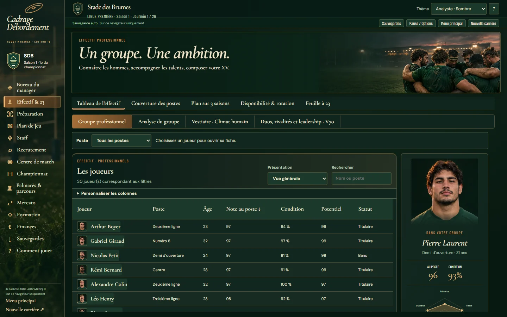
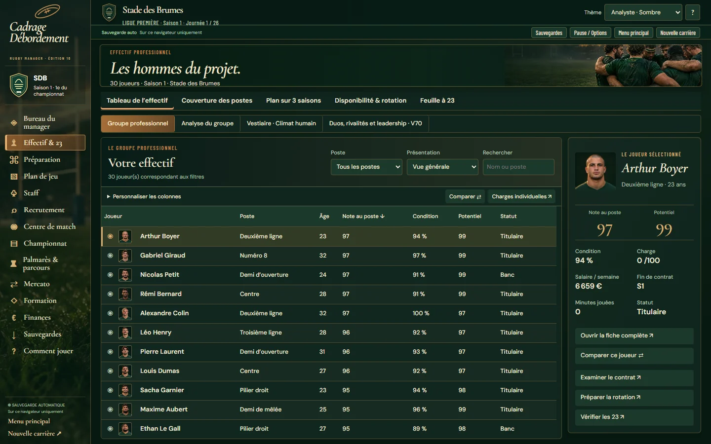
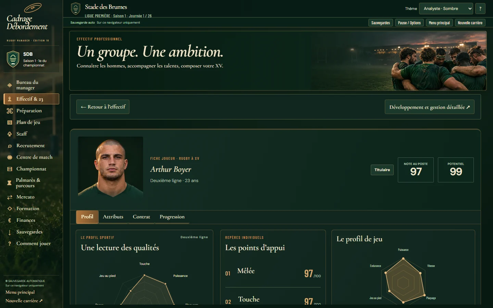
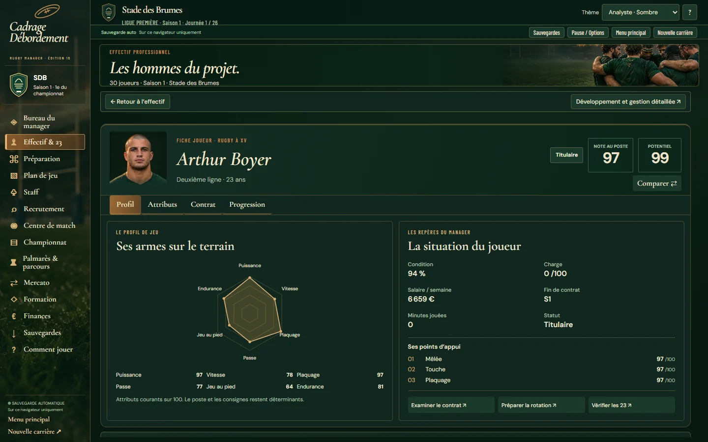
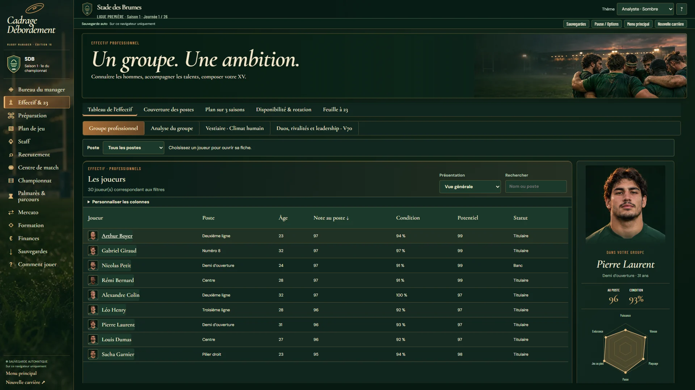
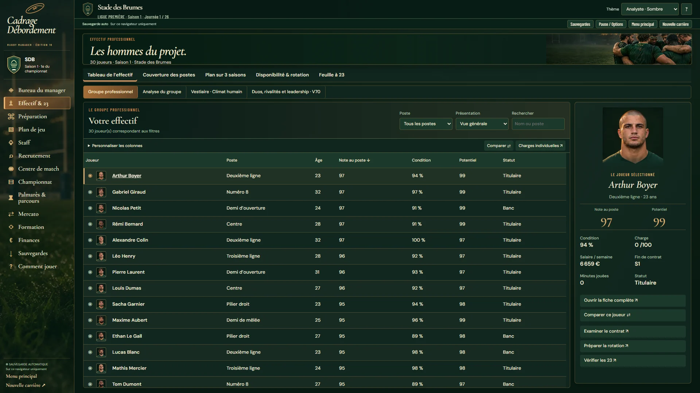
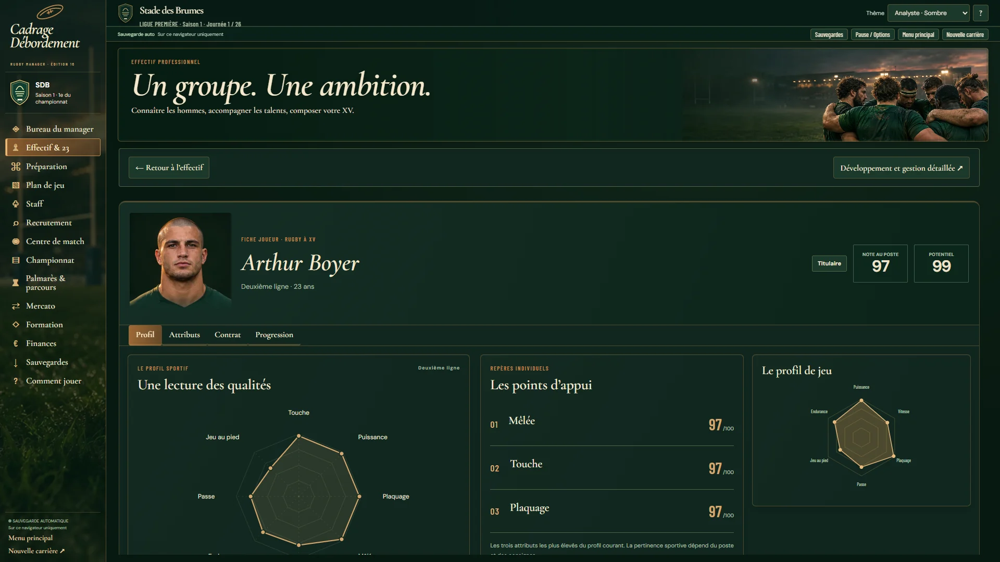
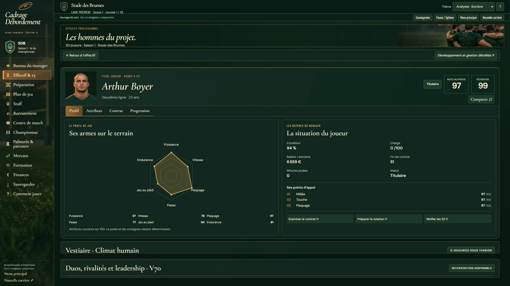

# Effectif et fiches joueurs Premium — 7 novembre 2026

Lot autorisé par Léo après le Bureau #384. Jeu natif `dist/`, aucune application parallèle. Réservation [#73, commentaire 6706369722](https://github.com/Xynph/cadrage-debordement/issues/73#issuecomment-6706369722). Base initiale `f6434ff` ; QA #383 ensuite reçue sur main `044e83d`, trois ajouts disjoints.

Le tableau conserve la recherche, les postes, les quatre présentations, les colonnes personnalisées et le tri UI02. À 1440×900 : **11 lignes complètes**, contre 6 avant ; à 1920×1080 : **13 lignes**. L'en-tête et les commandes restent en place, les joueurs défilent dans le tableau. L'aperçu suit le joueur explicitement choisi, conserve son ID après tri et se réconcilie avec les filtres ; une liste vide n'affiche aucun ancien joueur.

La fiche présente une identité compacte et un seul radar. Chaque axe a sa valeur textuelle native sur 100 ; les trois points d'appui proviennent des attributs projetés UI02. Les onglets Attributs, Contrat et Progression restent natifs. Les actions ouvrent la couverture des postes, la feuille à 23 ou le contrat de ce joueur, sans décider à la place du manager.

Comparaison et charges réutilisent les commandes natives dans des fenêtres locales. Les sélections, le bouton d'effacement et les plans d'entraînement conservent leur focus lors du rendu ; Échap restitue le focus à l'action d'origine. Les plans respectent leurs verrouillages. Les portraits fictifs gardent leur identité ; LNR utilise des monogrammes.

## Réception Windows Chrome

- `node --test` ciblé : **24 sous-tests réussis**, dont sauvegardes, UI02, rotation, manager, finance et présentations Premium.
- Parcours `tests/premium-squad-browser.mjs` : **46 vérifications, 11 captures, aucune erreur JS**, carrière neuve puis export/import d'une carrière ayant réellement joué une journée par le moteur. Aucun score injecté.
- Consultation : état `S`, carrière persistée et nombre de tirages aléatoires inchangés. Les préférences de colonnes utilisent toujours leur stockage UI02 distinct.
- Les deux tailles PC, thèmes Analyste/Tribune, filtres vides, colonnes sans nom, nom très long, navigation contexte, focus, import et LNR sont couverts. Contraste des cinq textes/commandes échantillonnés : minimum **5,17:1**. Mesures détaillées : [rapport navigateur](premium-squad-captures/browser-windows.json).
- Régressions réelles : Bureau **75** contrôles, éditorial **315**, match dédié **284**, toutes réussies.
- Revue indépendante : aucun constat critique ou important ; disparition d'un joueur, effectif vide, import même club, toutes les colonnes et charges réellement modifiées vérifiés séparément. Perte de focus à l'effacement reproduite rouge puis corrigée et vérifiée.

Les tests de densité et de visibilité des actions ont échoué avant correction, puis sont passés. Le parcours du workflow `premium-squad.yml` qualifie aussi Chromium Linux et publie ses captures. La CI complète et le gate sur le SHA final, puis les sept jobs du main fusionné, sont à recevoir dans #73 ; aucune réussite distante n'est anticipée ici.

## Captures comparables

Même générateur natif déterministe, club et joueur sur les captures neuves.

| Écran | Avant | Après |
|---|---|---|
| Effectif 1440×900 |  |  |
| Fiche 1440×900 |  |  |
| Effectif 1920×1080 |  |  |
| Fiche 1920×1080 |  |  |

[Comparaison](premium-squad-captures/after/comparaison-1440.webp) · [Thème clair](premium-squad-captures/after/effectif-tribune-1440.webp) · [Carrière avancée](premium-squad-captures/after/fiche-avance-1440.webp) · [LNR](premium-squad-captures/after/fiche-lnr-1440.webp) · [Nom long](premium-squad-captures/after/fiche-nom-long-1440.webp).

## Limites

Ce lot améliore la consultation de l'effectif ; il ne modifie ni règles rugby, ni sélection automatique, ni contrats/économie métier, ni format de sauvegarde. Les montants demeurent ceux de la simulation, pas des budgets réels. Aucun travail MATCH3D, données LNR, gate ou release portable. Chrome Windows sur le jeu web natif testé ; exécutable portable Windows non certifié par ces tests. Les grands dossiers secondaires gardent un défilement local. Les petits écrans ne font pas partie de cette réception PC.
