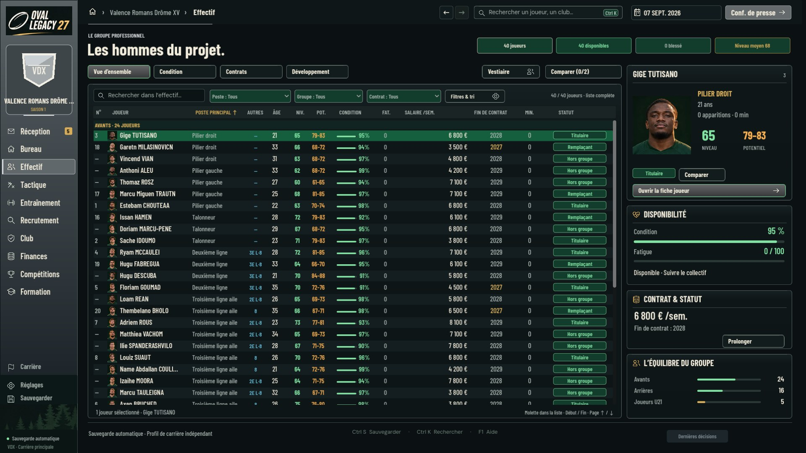
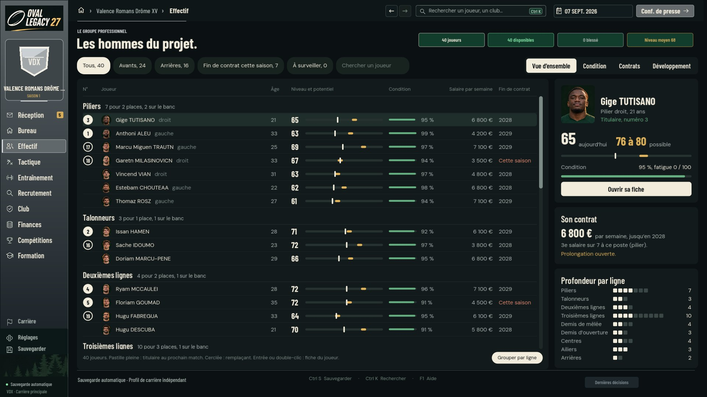
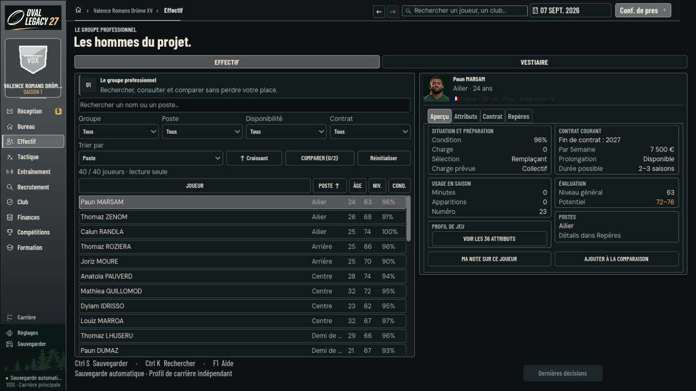
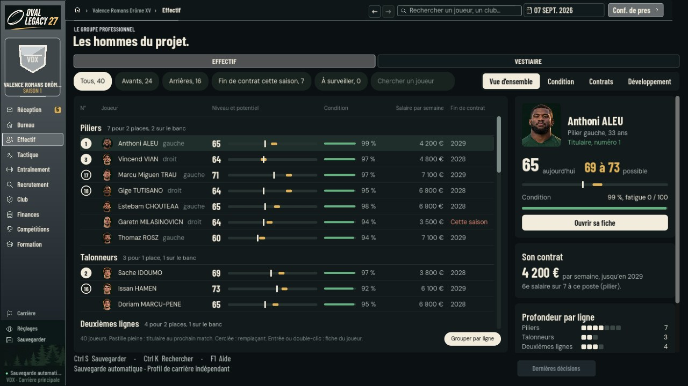

# Socle des menus : tableau commun et écran Effectif

Première moitié de la tranche de démonstration décidée dans
`docs/palier-genial-20261111.md` (PR #549). Relevé du 11 novembre 2026, sur
`fe79c365` (#539).

L'écran Effectif est reconstruit sur trois pièces nouvelles, réutilisables par
les autres écrans. **L'ancien écran reste en place** : le nouveau ne s'affiche
que sur demande.

| Avant, 1920×1080 | Après, 1920×1080 |
| --- | --- |
|  |  |

| Avant, 1280×720 | Après, 1280×720 |
| --- | --- |
|  |  |

En 2560×1440 : [capture](socle-menus-20261111/effectif-1440-apres.jpg).
Tri, liste sans groupes, vues Condition et Développement :
[planche](socle-menus-20261111/etats.jpg).

Toutes les captures viennent du vrai jeu lancé avec le vrai moteur, sous
Linux et Xvfb. Les niveaux diffèrent d'une capture à l'autre parce que chaque
carrière est créée avec ses propres variations.

## Ce qui change pour le joueur

- **Un seul écran de 1280×720 à 2560×1440.** Aujourd'hui, en dessous de 1600
  pixels de large, le jeu bascule sur un autre écran à cinq colonnes et onze
  lignes. Le nouveau garde la même lecture et retire les colonnes les moins
  utiles quand la place manque.
- **L'effectif se lit par ligne** : piliers, talonneurs, deuxièmes lignes…
  avec, pour chacune, le nombre de joueurs, de places sur le terrain et de
  remplaçants. Dans chaque ligne : titulaires, puis remplaçants, puis le
  reste, du meilleur au moins bon.
- **Niveau et potentiel sur une même barre** : le trait clair est le niveau
  actuel, le segment doré la fourchette de potentiel estimée.
- **Tout répond tout de suite.** Trier, filtrer, chercher, changer de vue ou
  de joueur ne demande rien au moteur.
- **Au clavier** : flèches, Page précédente et suivante, Début, Fin ; Entrée
  ouvre la fiche complète. À la souris : clic, double-clic, molette, clic sur
  un en-tête pour trier, second clic pour inverser.
- **Quatre vues** sur les mêmes joueurs : Vue d'ensemble, Condition,
  Contrats, Développement.

## Les trois pièces

| Fichier | Rôle |
| --- | --- |
| `native/godot/ui/socle/jetons.gd` | Jetons de design : couleurs, tailles de texte, espacements, rayons, polices, échelle. Étape 1 du plan de `docs/theme-unique-20261111.md` (PR #548). |
| `native/godot/ui/socle/tableau.gd` | Tableau commun : colonnes déclarées, tri, groupes, filtre, sélection, clavier, souris, infobulles. |
| `native/godot/ui/socle/ecran_effectif.gd` | L'écran Effectif, en conteneurs. Lit `app.model.squad` ; aucune commande du moteur. |

Un écran déclare ses colonnes ; le tableau fait le reste :

```gdscript
tableau.colonnes = [
	{"id": "joueur", "titre": "Joueur", "largeur": 226, "souple": 1.0, "gras": true,
		"valeur": func(j): return j.name, "texte": func(j): return j.name},
	{"id": "age", "titre": "Âge", "largeur": 40, "priorite": 3,
		"valeur": func(j): return j.age, "texte": func(j): return str(int(j.age))},
]
tableau.groupe_de = func(j): return int(j.fam)
tableau.definir_lignes(app.model.squad)
```

Trois choix de construction :

- **Les lignes sont dessinées, pas instanciées.** Seules les lignes visibles
  coûtent quelque chose : 40 joueurs ou 3 000, même fluidité. Seuls les
  portraits visibles existent comme nœuds.
- **Une valeur inconnue reste en bas**, dans les deux sens de tri. À valeur
  égale, l'ordre est celui des identifiants.
- **`priorite`** dit quelles colonnes partent en premier quand la largeur
  manque. Le texte ne descend pas sous 12 pixels.

## L'activer

Variable d'environnement `CD_SOCLE_EFFECTIF=1` au lancement du jeu. Deux
lignes ajoutées à `native/godot/ui/immersive08/shell.gd` font l'aiguillage ;
sans la variable, le jeu est inchangé. Il n'y a pas encore de réglage dans le
jeu : c'est voulu, pour ne toucher à aucun fichier partagé pendant le gel de
livraison.

## Tests

`tests/godot-socle-effectif.cjs`, autonome, sans fichier d'aide.

```bash
CD_GODOT_EXECUTABLE=<godot 4.7.2> node --test tests/godot-socle-effectif.cjs
CD_SOCLE_GRAPHICS=1 CD_SOCLE_OUTPUT=<dossier> xvfb-run -a node --test tests/godot-socle-effectif.cjs   # avec captures
```

| Contrôle | 1920×1080 | 1280×720 |
| --- | --- | --- |
| Contrôles passés, vrai jeu et vrai moteur, affichage X11 | 43 sur 43 | 43 sur 43 |
| Même parcours sans affichage (`--headless`) | Passe | Passe |
| Colonnes affichées en Vue d'ensemble | 7 sur 7 | 6 sur 7, sans l'âge |
| Tri de 40 joueurs | 0,4 ms | 0,4 ms |
| Tri de 3 000 lignes, calcul seul | 16 ms | 17 ms |
| Données du moteur et profil sur disque après le parcours | Inchangés | Inchangés |

Mesures prises dans un conteneur à deux processeurs sans carte graphique.

Constat au passage : `tests/godot-squad-column-sort.cjs`, qui teste l'ancien
écran, échoue sur `fe79c365` avec Godot réel (« Numérique croissant, zéro
connu, nul dernier et égalités ID : Potentiel »). L'échec est dans des
fonctions pures de `squad_canvas.gd`, que cette branche ne modifie pas ; il
était déjà relevé sur #543.

## Critères de la tranche

| Critère fixé avant de commencer | État |
| --- | --- |
| Trier, filtrer et ouvrir une fiche sans attente perceptible | Tri, filtre et sélection : vérifié. Ouverture de la fiche complète : elle repasse par l'ancien rendu de page, non mesurée. |
| Lisible sans réglage en 1280×720 et en 2560×1440 | Captures aux trois tailles ; texte courant de 12 à 20 pixels. À juger par Léo. |
| Trois gestes de rugby reconnaissables, 60 images par seconde | Seconde moitié de la tranche (match), pas commencée. |
| « C'est ce niveau » | À Léo de le dire. |

## Limites

- **Jamais lancé sous Windows.** Aucun exécutable construit avec cet écran.
- L'en-tête de page (« Les hommes du projet. » et ses quatre pastilles) est
  celui de l'ancienne interface : il n'a pas été refait.
- La fiche complète du joueur, la comparaison et le vestiaire restent ceux de
  l'ancien écran. « Comparer » n'est pas repris dans le nouveau.
- Pas encore de choix de colonnes ni de vues enregistrées.
- Les lignes étant dessinées, un lecteur d'écran ne les voit pas une à une.
  À traiter avant de généraliser le tableau.
- Les commandes du moteur renvoient toujours 5 Mo (constat E1 de l'audit) :
  « Jour suivant » reste aussi lent qu'avant. Ce chantier n'est pas dans
  cette branche.

## Suite

1. Léo regarde les captures et tranche sur la direction.
2. Après la fusion de la version commune : rebaser, ajouter un réglage dans
   le jeu, puis porter le recrutement et les contrats sur le même tableau.
3. Seconde moitié de la tranche : vingt secondes de match.
