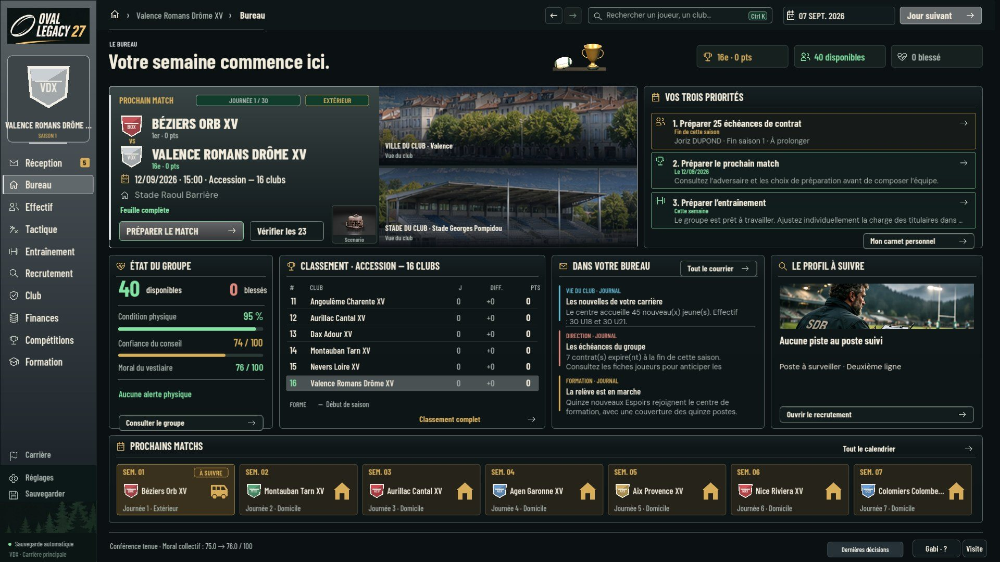
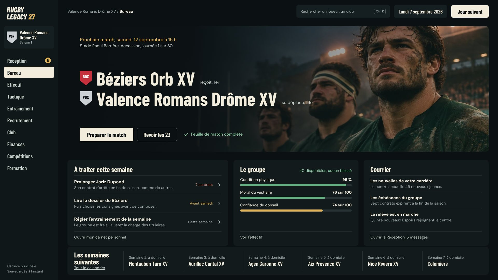
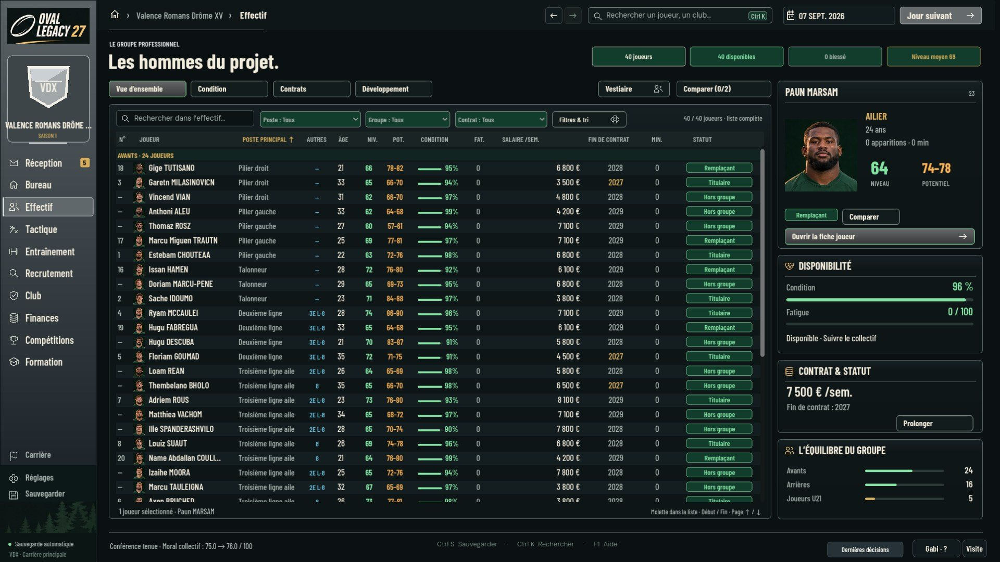
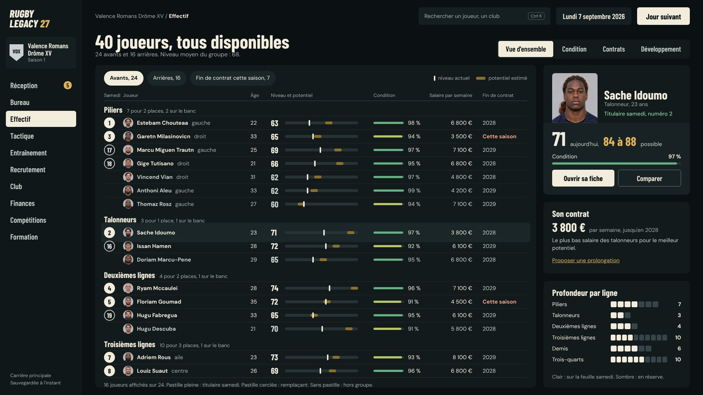
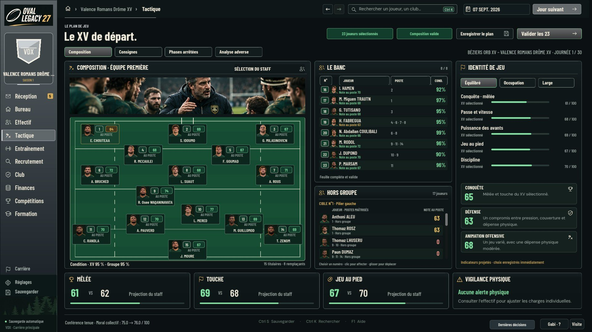
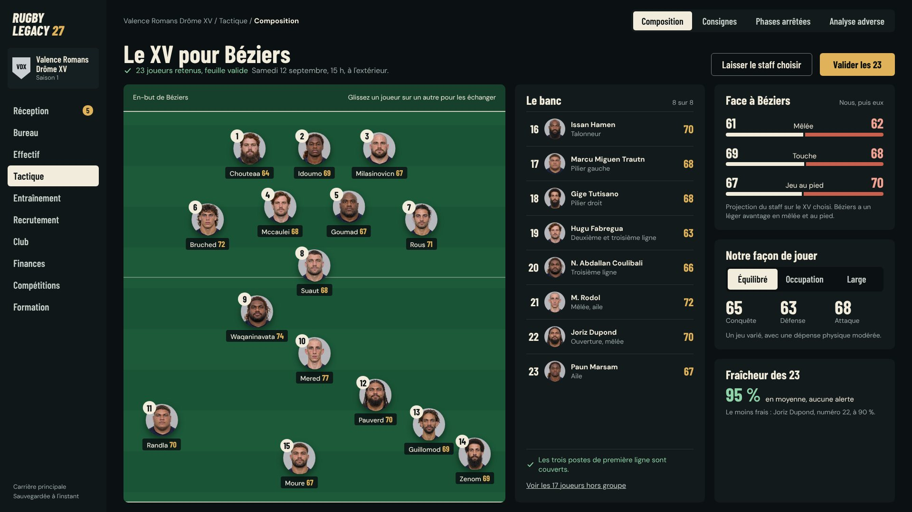

# Direction artistique des menus et plan de thème unique

Relevé du 11 novembre 2026 sur la branche de la PR #543 (`3b42dbf2`), captures
réelles en 1920×1080 obtenues en lançant le jeu sous Linux. Ce document
propose ; il ne modifie aucun écran.

## Constat sur la version actuelle

Les reproches faits aux captures 0.6 (espace vide, texte trop petit,
contrôles Godot par défaut) **ne tiennent plus** sur #543. L'univers est
cohérent : fond anthracite, ivoire, or, vert, illustrations et portraits. La
bonne suite est d'affiner cet univers, pas de le remplacer.

Ce qui reste à corriger, écran par écran :

| Écran | Défauts observés |
| --- | --- |
| Bureau | Neuf cadres de même poids, aucun élément principal. Titre sans information (« Votre semaine commence ici. »). Classement entièrement à zéro en début de saison. Bloc « Aucune piste au poste suivi » qui occupe un quart de la largeur. Texte des priorités tronqué. Deux chiffres contradictoires pour les contrats (25 et 7). |
| Effectif | Les trois statuts (titulaire, remplaçant, hors groupe) ont la même pastille verte. Niveau et potentiel sont deux colonnes de nombres à comparer de tête. Colonne « Autres » codée (« 3E L-8 »). Liste à plat, sans lecture de la profondeur par poste. |
| Composition | Terrain horizontal dont les lignes ne correspondent à aucune formation : le 9, le 10 et les centres sont alignés en diagonale, le pack est éparpillé. Les cartes des joueurs masquent le terrain. Le banc n'indique pas les postes couverts en clair. |
| Match (2560×1440) | Texte du score, des boutons et du journal très petit. Bouton « Tactique » présent deux fois. |

## Proposition

Trois maquettes à l'échelle, construites avec les illustrations, les portraits
et les polices du jeu (Barlow Condensed, DM Sans). Elles sont réalisables
telles quelles avec des contrôles Godot.

| Version actuelle (#543) | Proposition |
| --- | --- |
|  |  |
|  |  |
|  |  |

Principes retenus :

1. **Un élément principal par écran.** Au Bureau, le prochain match occupe
   la moitié haute avec l'illustration du jeu ; le reste se lit en dessous.
2. **Des surfaces, pas des cadres.** Les panneaux se distinguent par leur
   teinte et leur espacement. Les contours ne servent plus qu'aux champs et
   aux boutons secondaires.
3. **Corps de 15 à 17 px en 1080p**, titres en capitales et minuscules. Les
   capitales restent réservées au logo.
4. **Les nombres comparés se lisent sur un même axe** : niveau et potentiel
   sur une barre, rapport de forces en barres opposées, profondeur par ligne
   en cases.
5. **L'état se lit sans légende** : pastille pleine pour un titulaire,
   cerclée pour un remplaçant, absente hors groupe ; rouge réservé à ce qui
   expire ou bloque.
6. **Un écran vide ne s'affiche pas.** En début de saison, le classement et
   les pistes de recrutement cèdent leur place.

Les textes des maquettes reprennent les données de la capture. Les formules
d'aide (« Le plus bas salaire des talonneurs… ») sont des exemples de ce que
l'écran pourrait calculer, à valider.

## État du code

Quatre couches de style coexistent, avec des valeurs divergentes :

| Couche | Fichier | Fond | Or | Usage |
| --- | --- | --- | --- | --- |
| Thème d'origine | `native/godot/theme.gd` (119 lignes) | `#151b1f` | — | 398 appels dans 44 fichiers |
| Habillage « jeu » | `ui/game_skin.gd` (358 lignes) | `#151b1f` | `#ddbd80` | 41 fichiers |
| Habillage « carnet » | `ui/carnet_skin.gd` (275 lignes) | `#151b1f`, panneaux ivoire | `#82592e` | 38 fichiers |
| Immersif | `ui/immersive08/components.gd`, `primitives.gd`, `legacy_style.gd` | `#0b1012` | `#d7ad59` | 13 866 lignes ; contrôles placés en coordonnées absolues sur une toile de 2560×1440 |

Conséquences : une couleur se change à quatre endroits ; les écrans
immersifs ne se réorganisent pas (une liste plus longue ou un texte traduit
déborde) ; la navigation au clavier dépend de l'ordre de création des
contrôles.

## Plan en quatre étapes

Chaque étape est une PR autonome, livrable seule.

### 1. Une seule source de jetons (faible risque)

Créer `native/godot/ui/design_tokens.gd` : couleurs, tailles de texte,
espacements, rayons, hauteurs de commande. Les quatre couches gardent leurs
noms de constantes mais lisent ces jetons. Aucune capture ne doit changer,
sauf l'alignement voulu des quatre ors et des deux fonds sur les valeurs de
l'immersif.

Collisions : `theme.gd` et `game_skin.gd` ne sont modifiés par aucune PR non
intégrée ; `carnet_skin.gd` et `immersive08/components.gd` seulement par
#400 et #411, les PR d'origine de l'interface immersive, en partie présentes
dans #543. Cette étape peut partir dès
l'intégration de #543.

Preuve : les captures de la recette intégrée (`CD_GODOT_SELF_TEST`) avant et
après, comparées image par image.

### 2. Un vrai `Theme` Godot

Construire une ressource `Theme` à partir des jetons : `Button`, `Label`,
`LineEdit`, `OptionButton`, `Tree`, `TabBar`, `PanelContainer`,
`ScrollContainer`, avec des variations nommées (`Titre`, `Chiffre`,
`BoutonPrincipal`, `Pastille`). Les styles créés à la main (`StyleBoxFlat`
dans les habillages) passent par ces variations.

### 3. Trois écrans pilotes en conteneurs

Refaire Bureau, Effectif et Composition avec `VBoxContainer`,
`HBoxContainer`, `GridContainer` et le `Theme`, d'après les maquettes.
L'Effectif sert de modèle au **tableau commun** : tri par colonne, filtres,
sélection, clavier. Ce tableau est ensuite réutilisé pour le recrutement, les
contrats et les classements.

Collisions fortes : 20 PR non intégrées touchent les écrans d'effectif, 16 le
Bureau, 13 la tactique (liste dans l'audit). À faire après leur tri.

### 4. Retrait des anciennes couches

Migrer les écrans restants par rubrique, puis supprimer `game_skin.gd`,
`carnet_skin.gd` et `legacy_style.gd`. Un test échoue si un script crée une
couleur en dur hors du fichier de jetons.

## Règle pour les PR d'interface pendant la migration

Une PR qui touche un écran pilote attend l'étape 3 ou se rebase dessus. Les
autres continuent, à condition de ne plus ajouter de couleur ni de taille de
texte en dur.

## Vérification

Les maquettes ont été relues sur leur rendu en 1920×1080. Elles n'ont pas été
essayées en 1280×720 ni en 2560×1440, ni construites dans Godot.
